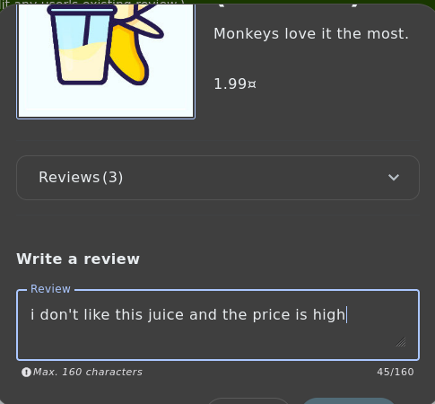
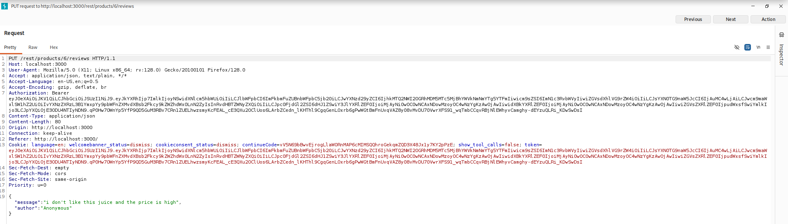

# Test T-A01-02 -- Modification non autorisée d'un avis produit (Forged Review / IDOR)

**Catégorie :** A01 -- Broken Access Control (Contrôle d'accès défaillant — inclut désormais le SSRF)

**1. Description générale**

Ce test vise à vérifier si un utilisateur authentifié peut modifier le contenu d'un avis produit rédigé par un autre utilisateur, alors que cet avis est visible publiquement par l'ensemble des visiteurs du site.

**2. Faille spécifique**

L'endpoint PUT /rest/products/{id}/reviews permet de mettre à jour le contenu d'un avis existant. L'analyse de la requête interceptée montre que le serveur ne vérifie pas que l'utilisateur à l'origine de la requête (identifié par son jeton d'authentification) est bien l'auteur original de l'avis ciblé. Il s'agit d'une référence directe non sécurisée à un objet (IDOR) : un utilisateur authentifié peut modifier un avis dont il n'est pas l'auteur.

**3. Étapes de reproduction**

1.  Se connecter à l'application avec un compte utilisateur standard.

2.  Rédiger un avis sur un produit via le formulaire « Write a review ».

3.  Intercepter la requête d'écriture avec Burp Suite (Proxy).

4.  Identifier l'endpoint utilisé : PUT /rest/products/{id}/reviews, avec un corps JSON contenant les champs message et author.

5.  Rejouer ou modifier la requête interceptée en ciblant un avis appartenant à un autre utilisateur.

6.  Envoyer la requête modifiée : le serveur accepte la modification sans vérifier la propriété de l'avis.

**4. Preuve de concept**

Rédaction d'un avis via l'interface standard :

*Figure 12. Rédaction d'un avis produit via l'interface utilisateur standard.*

Requête PUT interceptée modifiant l'avis sans contrôle de propriété :

*Figure 13. Requête PUT interceptée dans Burp Suite modifiant un avis sans vérification de propriété.*

**5. Impact**

Cette faille permet à un utilisateur malveillant de modifier ou de falsifier le contenu des avis publiés par d'autres utilisateurs, avis visibles par l'ensemble des visiteurs du site. Cela porte atteinte à l'intégrité des données publiques de l'application et peut être exploité pour diffuser de fausses informations ou dénigrer des produits, avec un impact potentiel sur la réputation du site.

**6. Remédiation**

-   Vérifier systématiquement, côté serveur, que l'utilisateur authentifié à l'origine de la requête est bien le propriétaire de la ressource (avis) qu'il tente de modifier, avant toute opération d'écriture.

-   Appliquer un contrôle d'accès basé sur la propriété des ressources (object-level authorization) sur l'ensemble des endpoints de modification et de suppression.

-   Ajouter des tests automatisés de non-régression couvrant les scénarios d'accès croisé entre comptes utilisateurs.
