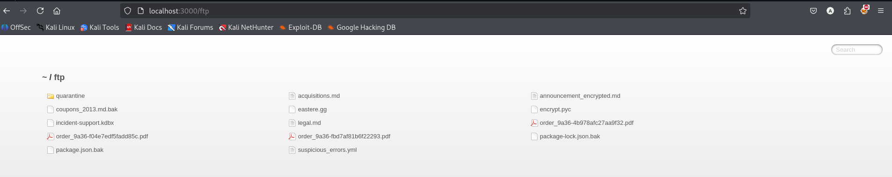
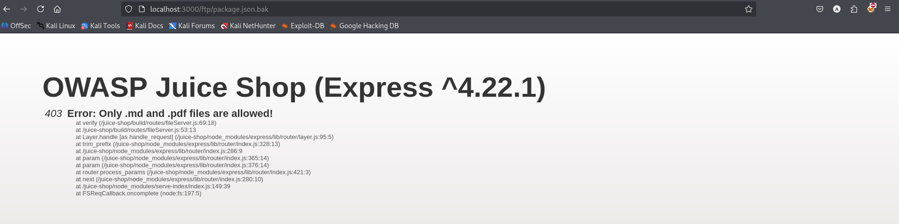
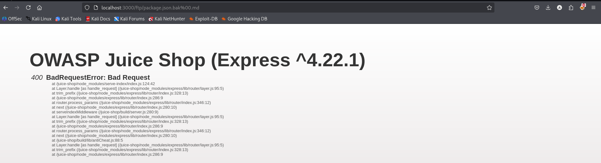
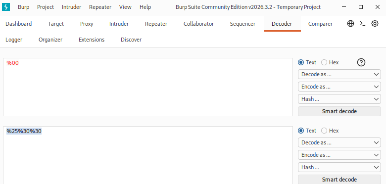
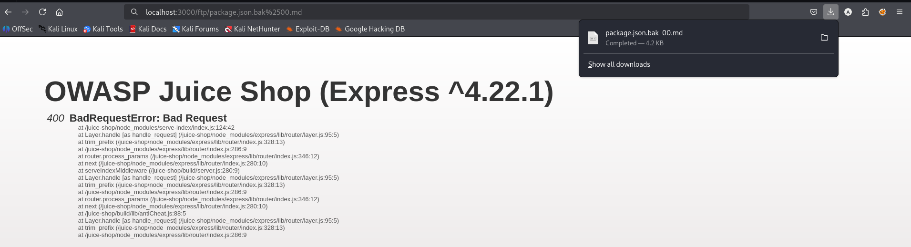
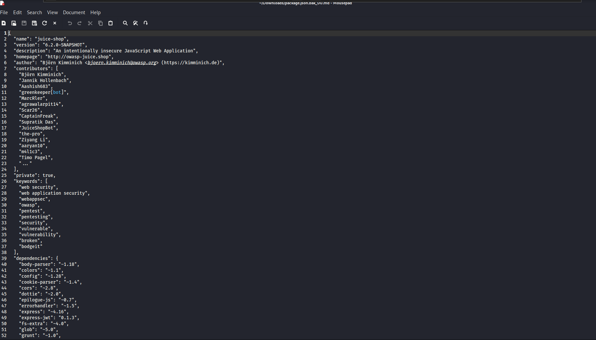

# Test T-A02-01 -- Exposition de fichiers de sauvegarde oubliés et contournement du filtrage d'extension (Forgotten Developer Backup)

**Catégorie :** A02 -- Security Misconfiguration (Mauvaise configuration de sécurité)

**1. Description générale**

Ce test vise à vérifier si des fichiers de développement ou de sauvegarde (artefacts .bak, .old, fichiers de configuration) sont restés accessibles publiquement suite à un oubli lors du déploiement, et si un mécanisme de filtrage d'extension mis en place pour en limiter l'accès peut être contourné.

**2. Faille spécifique**

Le répertoire /ftp de l'application est accessible publiquement et liste l'ensemble de son contenu, exposant l'existence de plusieurs fichiers sensibles (sauvegardes .bak, base de données de mots de passe .kdbx, scripts compilés .pyc). Un filtrage applicatif limite l'accès direct au contenu de ces fichiers aux seules extensions .md et .pdf. Ce filtrage, réalisé par une simple vérification de la fin de la chaîne de caractères du nom de fichier, peut être contourné par une technique de Null Byte Injection à double encodage URL (%2500), qui exploite une divergence entre la validation de l'extension et l'interprétation réelle du nom de fichier lors du traitement de la requête.

**3. Étapes de reproduction**

1.  Accéder au répertoire /ftp de l'application et constater le listage public de son contenu, incluant plusieurs fichiers aux extensions sensibles (package.json.bak, package-lock.json.bak, incident-support.kdbx, coupons_2013.md.bak, encrypt.pyc).

2.  Tenter d'accéder directement au fichier package.json.bak : le serveur retourne une erreur 403 « Only .md and .pdf files are allowed! », confirmant l'existence d'un filtrage par extension, mais révélant déjà par la même occasion une stack trace complète (chemin fileServer.js, structure interne).

3.  Tenter un contournement par Null Byte Injection simple : ajouter %00.md à la suite du nom du fichier cible (package.json.bak%00.md). La requête échoue avec une erreur 400 BadRequestError, le serveur rejetant ce caractère.

4.  Analyser dans Burp Suite Decoder l'encodage à appliquer pour un double encodage URL du byte nul : %00 encodé une seconde fois devient %2500.

5.  Retenter l'accès avec le nom de fichier suivi de %2500.md (package.json.bak%2500.md).

6.  Bien que le serveur affiche à nouveau une erreur 400 BadRequestError, constater dans le gestionnaire de téléchargements du navigateur que le fichier a néanmoins été transféré avec succès avant l'interruption du traitement côté serveur.

7.  Ouvrir le fichier téléchargé et confirmer l'exfiltration complète et lisible du contenu de package.json.bak.

**4. Preuve de concept**

Listage public du répertoire /ftp, exposant l'existence de fichiers sensibles :

*Figure 16. Listage public du répertoire /ftp révélant plusieurs fichiers de sauvegarde et de configuration sensibles.*

Filtrage par extension détecté (403), avec fuite additionnelle d'une stack trace :

*Figure 17. Erreur 403 confirmant un filtrage par extension, accompagnée d'une stack trace exposant la structure interne du serveur.*

Échec de la tentative de contournement par Null Byte Injection simple (%00) :

*Figure 18. Échec de la tentative de contournement par Null Byte Injection simple (%00), rejetée par le serveur (400).*

Construction du double encodage URL du byte nul via Burp Suite Decoder :

*Figure 19. Construction du double encodage URL du byte nul (%00 → %2500) via l'outil Decoder de Burp Suite.*

Résultat de la tentative avec double encodage : erreur affichée, mais téléchargement du fichier confirmé en arrière-plan :

*Figure 20. Téléchargement du fichier package.json.bak confirmé (notification de téléchargement) malgré l'erreur 400 affichée par le serveur.*

Contenu intégral du fichier exfiltré, confirmant l'exploitation réussie :

*Figure 21. Contenu complet du fichier package.json.bak exfiltré, révélant l'ensemble des dépendances de l'application.*

**5. Impact**

Impact technique : exposition du contenu intégral d'un fichier de configuration de développement, révélant la totalité des dépendances applicatives (nom et version exacte de chaque librairie tierce utilisée), des métadonnées internes du projet et des informations de contribution.

Impact indirect : un attaquant disposant de la liste précise des dépendances et de leurs versions peut cibler efficacement la recherche de vulnérabilités connues (CVE) sur chacune d'elles — cette information a d'ailleurs été directement réutilisée pour orienter les tests des catégories A03 (Software Supply Chain Failures, voir T-A03-01 et T-A03-02) menés dans le cadre de cet audit. Par ailleurs, le simple listage du répertoire expose déjà l'existence de fichiers hautement sensibles (base de mots de passe .kdbx notamment), ce qui constitue en soi une fuite d'information significative, indépendamment de la possibilité d'en exfiltrer le contenu.

**6. Remédiation**

-   Retirer systématiquement tout fichier de développement, de sauvegarde ou de configuration (.bak, .old, .kdbx, .pyc, dossiers .git) de l'environnement de production avant tout déploiement.

-   Désactiver le listage de répertoire (directory listing) sur l'ensemble des répertoires exposés publiquement par le serveur web.

-   Ne jamais reposer un contrôle de sécurité sur une simple vérification de suffixe de nom de fichier : valider le type réel du contenu (magic bytes) et normaliser/décoder entièrement le chemin demandé avant toute vérification.

-   Automatiser une vérification de l'absence de fichiers sensibles via un pipeline CI/CD avant chaque déploiement en production.
