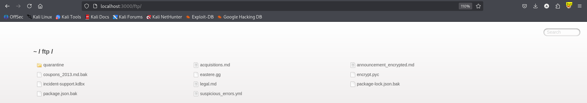
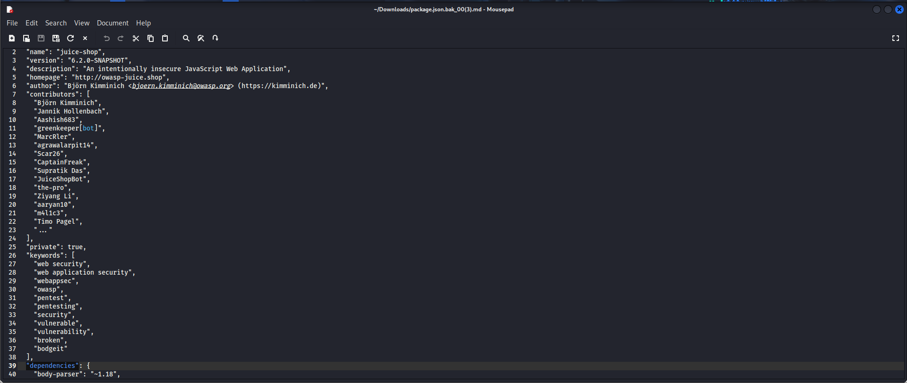
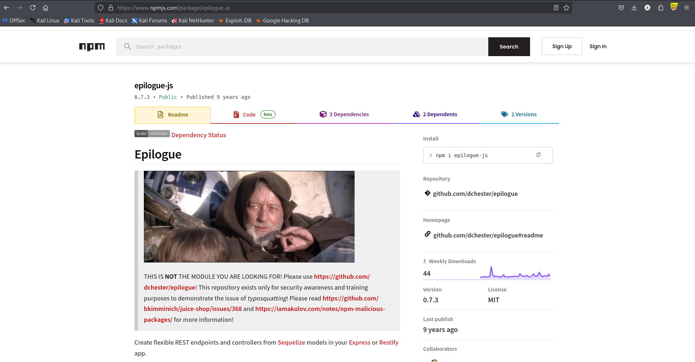

# Test T-A03-01 -- Identification d'une dépendance de type « typosquatting » dans les artefacts du projet (Legacy Typosquatting)

**Catégorie :** A03 -- Software Supply Chain Failures (Défaillances de la chaîne d'approvisionnement logicielle)

**1. Description générale**

Ce test vise à examiner la liste des dépendances tierces déclarées par l'application (obtenue via le fichier package.json.bak exfiltré en T-A02-01) afin d'y détecter d'éventuels packages malveillants exploitant la technique du typosquatting — c'est-à-dire des paquets publiés sous un nom délibérément proche d'une bibliothèque légitime et populaire, dans l'espoir qu'une erreur de frappe ou une copie non vérifiée conduise à leur installation à la place du package authentique.

**2. Faille spécifique**

L'examen de la section dependencies du fichier package.json.bak révèle la présence du package epilogue-js, dont le nom est très proche de la bibliothèque légitime et largement utilisée epilogue. La vérification de la fiche de ce package sur le registre npm confirme qu'il s'agit d'un cas de typosquatting : le mainteneur du package a lui-même neutralisé son contenu et publié un avertissement explicite indiquant qu'il ne s'agit pas du module recherché, le dépôt n'existant que pour illustrer ce type d'attaque de la chaîne d'approvisionnement logicielle.

**3. Étapes de reproduction**

1.  Réexaminer le fichier package.json.bak obtenu lors du test T-A02-01 et lister l'ensemble des dépendances déclarées dans sa section dependencies.

2.  Comparer visuellement chaque nom de dépendance aux noms de bibliothèques JavaScript légitimes et couramment utilisées, à la recherche d'anomalies orthographiques ou de suffixes suspects.

3.  Identifier la dépendance epilogue-js comme candidate suspecte (proche du package légitime epilogue, avec l'ajout du suffixe -js).

4.  Consulter la fiche du package epilogue-js sur le registre officiel npmjs.com afin de vérifier sa légitimité.

5.  Analyser le contenu de la page (README, avertissements du mainteneur) pour confirmer la nature du package.

**4. Preuve de concept**

Rappel du contexte : répertoire /ftp d'où provient le fichier de configuration analysé :

*Figure 22. Répertoire /ftp contenant le fichier package.json.bak analysé pour cette fiche.*

Extrait de la liste des dépendances du projet, incluant la dépendance suspecte epilogue-js :

*Figure 23. Liste des dépendances déclarées dans package.json.bak, incluant la dépendance suspecte « epilogue-js ».*

Vérification sur le registre npm officiel : le package est explicitement identifié comme une démonstration de typosquatting par son propre mainteneur :

*Figure 24. Fiche du package « epilogue-js » sur npmjs.com, confirmant explicitement qu'il s'agit d'une démonstration de typosquatting du package légitime « epilogue ».*

**5. Impact**

Dans un contexte réel (hors démonstration pédagogique volontaire de Juice Shop), l'installation d'un package typosquatté équivaudrait à l'exécution de code arbitraire et non vérifié directement au sein de l'environnement de build ou d'exécution de l'application, avec un accès potentiel à l'ensemble des secrets, variables d'environnement et données traitées par le processus. Ce test illustre un risque structurel de la chaîne d'approvisionnement logicielle : la confiance accordée par défaut à toute dépendance tierce installée, sans vérification de son authenticité ni de la réputation de son auteur.

**6. Remédiation**

-   Vérifier systématiquement l'orthographe exacte, le nombre de téléchargements, la réputation et l'ancienneté de tout nouveau package avant son ajout aux dépendances d'un projet.

-   Utiliser des outils de détection automatique de typosquatting et de packages malveillants intégrés au pipeline CI/CD (ex. Socket.dev, npm audit, Snyk).

-   Verrouiller les versions exactes des dépendances (lockfile) et n'autoriser leur mise à jour qu'après revue explicite.

-   Sensibiliser les équipes de développement à la vérification manuelle du nom exact d'un package avant toute commande d'installation.
