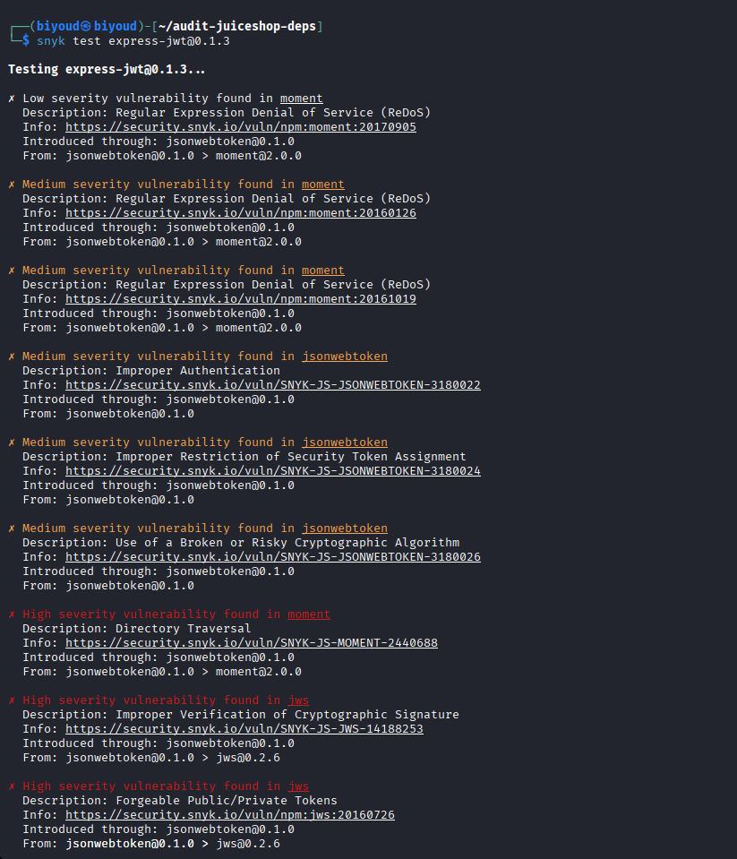

# Test T-A03-02 -- Bibliothèque tierce obsolète et vulnérable (express-jwt 0.1.3 — recherche de CVE via Snyk)

**Catégorie :** A03 -- Software Supply Chain Failures (Défaillances de la chaîne d'approvisionnement logicielle)

**1. Description générale**

Ce test vise à vérifier si les bibliothèques tierces utilisées par l'application, en particulier celles impliquées dans des mécanismes de sécurité critiques (authentification), sont à jour et exemptes de vulnérabilités connues et documentées publiquement (CVE).

**2. Faille spécifique**

L'analyse du fichier package.json de sauvegarde (obtenu en T-A02-01) a révélé une déclaration de dépendance `express-jwt` en version 0.1.3. La sauvegarde seule ne prouve pas que cette version était installée ou chargée par le processus exécuté. `express-jwt` est un middleware Express destiné à la validation de tokens JWT. Lors de l'analyse consignée, Snyk a signalé cette version comme affectée par une vulnérabilité de type Authorization Bypass (SNYK-JS-EXPRESSJWT-575022, sévérité élevée). La sortie Snyk présentée signale également des vulnérabilités dans le graphe de dépendances associé à cet instantané, notamment sur `jsonwebtoken`, `jws` et `moment`. Ces résultats concernent le graphe analysé à cette date et ne prouvent pas que ces versions étaient chargées dans le processus exécuté. Dans l'instantané de résultat illustré, l'outil liste 12 vulnérabilités sur 13 chemins de dépendances. Ce nombre dépend de la date et de la base de données Snyk ; il doit être accompagné de la sortie datée pour être reproduit.

**3. Étapes de reproduction**

1.  À partir du fichier package.json exfiltré (T-A02-01), extraire la dépendance concernant l'authentification et sa version exacte : express-jwt@0.1.3.

2.  Installer Snyk CLI et noter sa version, la date de l'analyse ainsi que la source de vulnérabilités interrogée.

3.  Reconstituer un projet minimal isolé avec la dépendance exacte dans son manifeste, puis lancer l'analyse Snyk selon la syntaxe prise en charge par la version de CLI utilisée. Conserver le manifeste, le lockfile et la sortie complète.

4.  Analyser la sortie listant l'ensemble des vulnérabilités trouvées, classées par niveau de sévérité.

5.  Identifier la vulnérabilité la plus critique directement attribuée au package testé (Authorization Bypass, sévérité élevée) ainsi que celles affectant ses dépendances transitives.

**4. Preuve de concept**

$ snyk test express-jwt@0.1.3

Sortie de l'analyse Snyk, listant l'ensemble des vulnérabilités identifiées sur le package et ses dépendances transitives (12 vulnérabilités, 13 chemins de dépendances) :

*Figure 25. Résultat de l'analyse Snyk sur express-jwt@0.1.3 : 12 vulnérabilités confirmées, dont une Authorization Bypass (élevée) et une Authentication Bypass (élevée) sur jsonwebtoken.*

**5. Impact**

Confidentialité (Critique) : un contournement d'autorisation (Authorization Bypass) permettrait l'accès à des ressources protégées sans validation légitime du jeton d'authentification.

Intégrité (Critique) : les vulnérabilités identifiées sur les dépendances transitives (jsonwebtoken, jws) suggèrent la possibilité de forger un token JWT accepté par le serveur sans posséder la clé secrète légitime, un scénario cohérent avec les mécanismes classiques de confusion d'algorithme JWT (voir également le test T-A04-01 sur l'attaque alg:none).

Disponibilité (Moyenne) : non impactée directement, sauf via les vulnérabilités de type ReDoS (Regular Expression Denial of Service) identifiées sur la dépendance transitive moment.

Ce cas illustre un phénomène caractéristique de la catégorie A03 : le risque ne se limite pas au package déclaré directement, mais se propage à travers plusieurs niveaux de dépendances transitives (express-jwt → jsonwebtoken → jws / moment), chacune apportant ses propres failles, invisibles sans un outil d'analyse dédié. Cette découverte est par ailleurs cohérente avec les constats réalisés sur l'authentification de l'application (catégorie A07) : la présence d'une bibliothèque d'authentification elle-même vulnérable renforce et explique structurellement les faiblesses observées à ce niveau.

**6. Remédiation**

-   Vérifier le manifeste et le lockfile réellement utilisés en production, puis mettre à jour vers des versions corrigées compatibles. Vérifier ensuite le graphe de dépendances et exécuter les tests de sécurité et de non-régression.

-   Intégrer un outil d'analyse de dépendances (snyk test ou npm audit) dans le pipeline CI/CD, avec blocage automatique de tout déploiement présentant des vulnérabilités critiques non corrigées.

-   Mettre en place une surveillance continue des dépendances (ex. snyk monitor) afin d'être alerté automatiquement en cas de nouvelle vulnérabilité découverte après déploiement.

-   Auditer spécifiquement les dépendances transitives, et pas seulement les dépendances directes, le risque pouvant être invisible à première vue.

-   Envisager, à moyen terme, le remplacement par une bibliothèque JWT activement maintenue et largement auditée (ex. jose).
