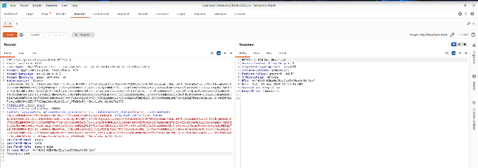
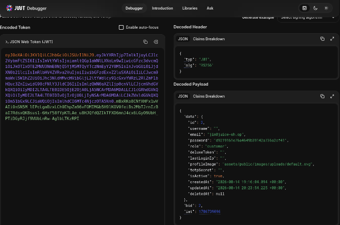
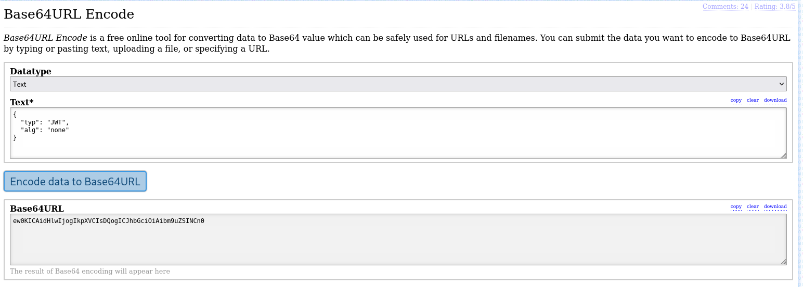
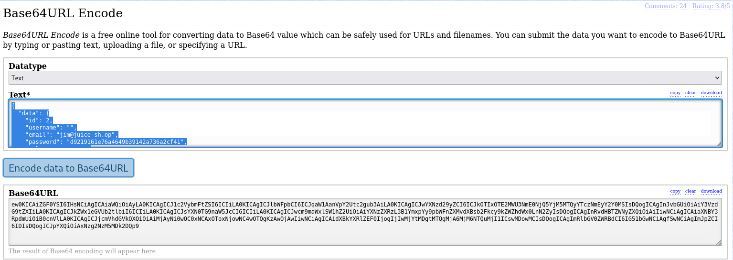
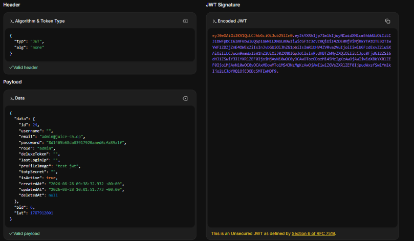
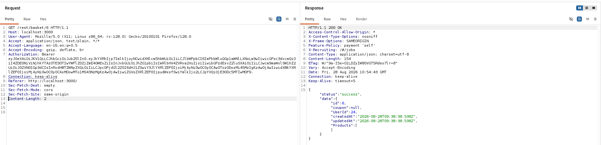

# Test T-A04-01 -- Falsification d'un token JWT non signé (attaque « alg: none »)

**Catégorie :** A04 -- Cryptographic Failures (Défaillances cryptographiques)

**1. Description générale**

Ce test vise à vérifier si l'application accepte des jetons JWT dont la signature a été supprimée ou désactivée (attaque dite « alg: none »), ce qui permettrait à un attaquant de forger un jeton valide pour n'importe quel compte utilisateur sans connaître la clé secrète de signature du serveur.

**2. Faille spécifique**

Les jetons JWT interceptés sont signés en RS256. La spécification JWT autorise cependant la valeur alg: none, indiquant l'absence de signature. Si le serveur ne rejette pas explicitement cette valeur et accepte un jeton non signé, un attaquant peut modifier librement le contenu du payload (identité, rôle, droits) sans que l'intégrité du jeton ne soit vérifiable.

**3. Étapes de reproduction**

1.  Intercepter un jeton JWT valide (compte jim@juice-sh.op) via Burp Suite Repeater.

2.  Décoder le jeton (header et payload) à l'aide de l'outil jwt.io Debugger afin d'en analyser la structure.

3.  Construire un nouvel en-tête JWT : {"typ":"JWT","alg":"none"}.

4.  Encoder cet en-tête en Base64URL.

5.  Encoder le payload d'origine (données utilisateur) en Base64URL.

6.  Concaténer les deux éléments (header.payload.) pour obtenir un jeton non signé.

7.  Soumettre le jeton forgé dans l'en-tête Authorization: Bearer, sans cookie de session ni en-tête If-None-Match, sur une requête GET /rest/user/whoami : le serveur répond 200 OK mais retourne un objet utilisateur vide ("user":{}), signe que le middleware ne rejette pas explicitement le jeton mais échoue à en extraire les données sur cet endpoint particulier.

8.  Reproduire le test sur un endpoint à contrôle d'accès strict, GET /rest/basket/{bid}, avec le bid (6) présent dans le payload forgé.

9.  Le serveur répond 200 OK et retourne le contenu réel du panier, avec "UserId":24 — l'identifiant inséré dans le jeton forgé — confirmant que le serveur a bien utilisé les données du jeton non signé pour autoriser l'accès à une ressource protégée.

**4. Preuve de concept**

Interception d'un jeton JWT valide :



*Figure 26. Interception d'un token JWT valide via Burp Suite Repeater.*

Décodage du jeton intercepté :



*Figure 27. Décodage du token JWT (header/payload) via l'outil jwt.io Debugger.*

Construction du nouvel en-tête non signé :



*Figure 28. Construction d'un nouvel en-tête JWT avec l'algorithme « none », encodé en Base64URL.*

Encodage du payload :



*Figure 29. Encodage en Base64URL du payload utilisé pour la construction du token non signé.*

Validation du jeton forgé avant soumission — l'outil confirme un en-tête et un payload valides syntaxiquement, tout en signalant explicitement qu'il s'agit d'un jeton non sécurisé au sens de la RFC 7519 :



*Figure 30. Validation syntaxique du jeton JWT forgé (alg: none), signalé comme non sécurisé par l'outil conformément à la RFC 7519.*

Soumission du jeton forgé sur l'endpoint /rest/basket/6 (sans cookie de session) et réponse du serveur :



*Figure 31. Requête GET /rest/basket/6 avec le jeton forgé en en-tête Authorization, et réponse du serveur confirmant l'accès autorisé ("UserId":24) sans vérification de signature.*

Un premier test sur /rest/user/whoami avait initialement renvoyé un objet vide, ce qui aurait pu être interprété à tort comme un rejet du jeton. La reproduction sur un endpoint à contrôle d'accès réellement contraignant (/rest/basket/{id}) lève cette ambiguïté et confirme sans équivoque l'acceptation du jeton non signé par le serveur.

**5. Impact**

Confidentialité — impact critique : accès à des ressources appartenant à n'importe quel utilisateur (y compris administrateur) en falsifiant un jeton non signé, sans connaître aucun mot de passe.

Intégrité — impact critique : toute action reposant uniquement sur la présence d'un jeton, sans re-vérification du mot de passe, devient usurpable.

Disponibilité — impact faible : non directement affectée par cette vulnérabilité.

Cette vulnérabilité permet une usurpation d'identité complète et arbitraire : il suffit de connaître l'identifiant numérique d'un compte cible — ici obtenu par une précédente injection SQL (T-A05-02) — pour forger un jeton valide à ses yeux, sans jamais posséder son mot de passe ni la clé de signature du serveur. Combinée aux autres accès administrateur déjà obtenus dans cet audit (T-A01-01, T-A07-01, T-A08-01), elle constitue un quatrième chemin indépendant vers la compromission de comptes à privilèges.

**6. Remédiation**

-   Configurer explicitement la bibliothèque de vérification JWT côté serveur pour n'accepter qu'une liste blanche d'algorithmes autorisés (ex. RS256 uniquement), en rejetant systématiquement alg: none.

-   Ne jamais déterminer l'algorithme de vérification à partir du contenu du jeton lui-même : toujours l'imposer côté serveur.

-   Vérifier la signature avec la clé publique correspondante avant toute utilisation des informations du payload.

```{=html}
<!-- -->
```
-   Faire échouer explicitement (401) toute requête dont le jeton ne peut être authentifié, plutôt que de retourner un objet vide en cas d'échec silencieux (comportement observé sur /rest/user/whoami).
