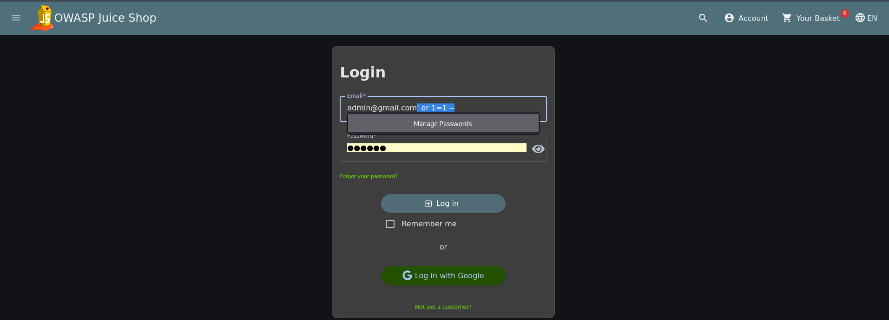
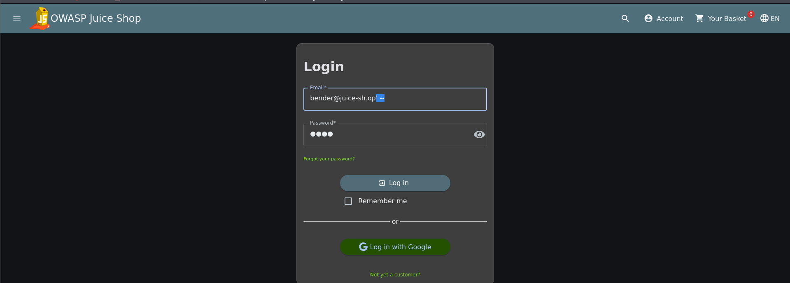
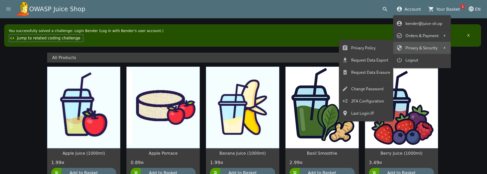

# Test T-A05-01 -- Contournement d'authentification par injection SQL classique

**Catégorie :** A05 -- Injection

**1. Description générale**

Ce test vise à démontrer, au niveau de la technique d'injection elle-même, que le formulaire d'authentification de l'application est vulnérable à l'injection SQL classique de type « tautologie » (payload booléen toujours vrai) et de type « commentaire » (troncature de la requête). Le test T-A01-01 documente la conséquence de cette faille en termes de contrôle d'accès (accès au panneau d'administration) ; ce test-ci se concentre sur le mécanisme d'injection et sa généralisation à un compte cible arbitraire.

**2. Faille spécifique**

Le champ email du formulaire de connexion est concaténé directement dans la requête SQL exécutée côté serveur (endpoint POST /rest/user/login), sans utilisation de requêtes paramétrées. Un attaquant peut donc injecter des fragments de syntaxe SQL qui altèrent la logique de la requête, par exemple en ajoutant une condition toujours vraie (' or 1=1 –) qui fait échouer la vérification du mot de passe tout en validant la requête pour le premier compte de la base.

Cette même faille permet également de cibler un compte utilisateur précis en injectant directement l'adresse email de la victime suivie d'un commentaire SQL (ex. bender@juice-sh.op'–), ce qui neutralise la comparaison du mot de passe pour ce compte spécifique et permet une authentification sans en connaître les identifiants.

**3. Étapes de reproduction**

1.  Sur le formulaire de connexion, saisir un email invalide et un mot de passe quelconque afin de confirmer le comportement nominal (rejet avec message « Invalid email or password »).

2.  Saisir dans le champ email le payload admin@gmail.com' or 1=1 – et un mot de passe quelconque.

3.  Soumettre le formulaire : l'application authentifie l'attaquant en tant que premier compte utilisateur de la base (admin@juice-sh.op), sans connaître son mot de passe.

4.  Répéter la technique en ciblant un compte spécifique : saisir bender@juice-sh.op'– dans le champ email.

5.  Soumettre le formulaire : l'application authentifie directement l'attaquant en tant que bender@juice-sh.op.

6.  Constater la résolution du challenge applicatif « Login Bender » et la présence du compte bender@juice-sh.op dans le menu utilisateur, confirmant l'authentification réussie sans mot de passe valide.

**4. Preuve de concept**

Injection du payload directement dans le champ email du formulaire (visible côté client) :

*Figure 32. Payload d'injection SQL saisi dans le champ email du formulaire de connexion.*

Ciblage d'un compte spécifique par injection avec commentaire SQL :

*Figure 33. Connexion ciblée sur le compte bender@juice-sh.op via injection SQL (bender@juice-sh.op'–).*

Confirmation de l'authentification réussie et résolution du challenge applicatif :

*Figure 34. Challenge « Login Bender » résolu — authentification obtenue sans mot de passe valide.*

Note : la preuve de concept complète au niveau protocolaire (requêtes/réponses HTTP interceptées via Burp Suite pour la variante ciblant le compte administrateur) est présentée dans la fiche T-A01-01, à laquelle ce test renvoie pour éviter la duplication des mêmes échanges.

**5. Impact**

Cette faille a permis, dans les comptes testés, de s'authentifier sans mot de passe valide. Les preuves documentent le compte administrateur et le compte Bender ; elles ne permettent pas d'affirmer que tous les comptes seraient exploitables avec le même résultat. La prise de contrôle du compte administrateur est la conséquence de cette injection, documentée avec plus de contexte dans T-A01-01 ; elle ne résulte pas d'une absence générale de contrôle d'accès côté serveur. Il s'agit d'une vulnérabilité fondamentale compromettant l'ensemble du modèle d'authentification de l'application.

**6. Remédiation**

-   Utiliser systématiquement des requêtes paramétrées (prepared statements) ou un ORM pour toute requête impliquant une donnée fournie par l'utilisateur, sans exception.

-   Ne jamais construire de requêtes SQL par concaténation de chaînes de caractères.

-   Mettre en place une validation stricte du format des champs d'authentification (ex. format email) en amont de la requête.

-   Déployer une solution de détection des tentatives d'injection (WAF applicatif) en complément de la correction du code.
