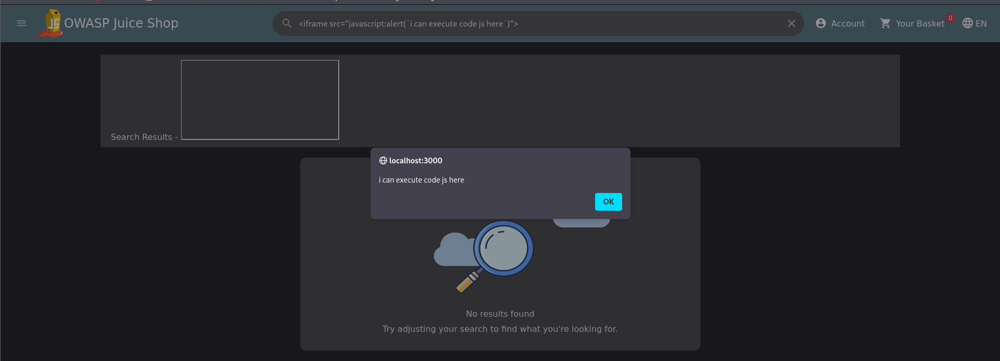
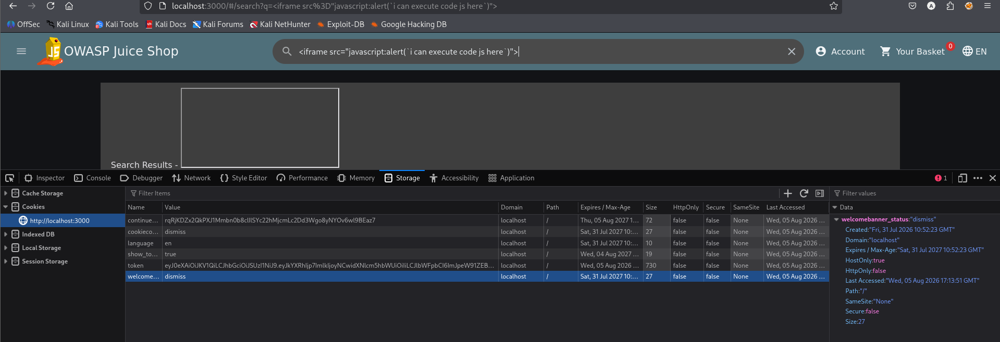

# Test T-A05-03 -- Cross-Site Scripting (XSS) réfléchi via le champ de recherche

**Catégorie :** A05 -- Injection

**1. Description générale**

Ce test vise à vérifier si le terme de recherche saisi par l'utilisateur est correctement neutralisé (échappé) avant d'être réinjecté dans le DOM de la page de résultats, ou si l'application est vulnérable à une injection de contenu HTML/JavaScript exécutable (XSS réfléchi).

**2. Faille spécifique**

Le terme de recherche est réinjecté dans la page de résultats sans neutralisation suffisante des balises HTML. Un attaquant peut ainsi injecter une balise <iframe> dont l'attribut src exploite le pseudo-protocole javascript: pour exécuter un script arbitraire dans le contexte du site (origine localhost:3000) dès l'affichage de la page de résultats.

**3. Étapes de reproduction**

1.  Accéder au champ de recherche de l'application.

2.  Saisir le payload suivant : <iframe src="javascript:alert(`i can execute code js here`)">

3.  Valider la recherche et observer le comportement de la page de résultats.

4.  Constater l'exécution immédiate du code JavaScript injecté, matérialisée par une boîte de dialogue native du navigateur.

5.  Inspecter les cookies de session de l'application (onglet Storage des DevTools) afin d'évaluer le risque de vol de session associé.

**4. Preuve de concept**

Exécution du script injecté, confirmée par une boîte de dialogue native déclenchée automatiquement à l'affichage de la page :

*Figure 41. Exécution du code JavaScript injecté via le champ de recherche (attaque XSS réfléchie confirmée).*

Analyse des cookies de session de l'application : le cookie token, contenant le jeton d'authentification JWT, est configuré avec l'attribut HttpOnly à false, le rendant accessible en JavaScript et donc exposé à un vol via XSS :

*Figure 42. Cookie de session « token » accessible en JavaScript (HttpOnly: false), aggravant l'impact d'une exploitation XSS.*

**5. Impact**

Cette vulnérabilité permet à un attaquant d'exécuter du code JavaScript arbitraire dans le navigateur d'une victime qui ouvrirait un lien contenant le payload malveillant. Le cookie de session token n'étant pas protégé par l'attribut HttpOnly, un tel script pourrait accéder directement à ce cookie (document.cookie) et l'exfiltrer vers un serveur contrôlé par l'attaquant, permettant un détournement de session complet (session hijacking) et donc une usurpation d'identité de la victime, sans qu'il soit nécessaire de connaître son mot de passe.

**6. Remédiation**

-   Échapper systématiquement (encodage HTML) toute donnée utilisateur avant son insertion dans le DOM, en particulier les résultats de recherche affichés à l'utilisateur.

-   Mettre en place une politique de sécurité de contenu (Content-Security-Policy) restrictive interdisant l'exécution de scripts inline et de pseudo-protocoles dangereux tels que javascript:.

-   Configurer l'attribut HttpOnly sur le cookie de session afin d'empêcher tout accès à celui-ci depuis du code JavaScript côté client.

-   Configurer également les attributs Secure et SameSite sur les cookies de session afin de limiter davantage les vecteurs d'attaque.
