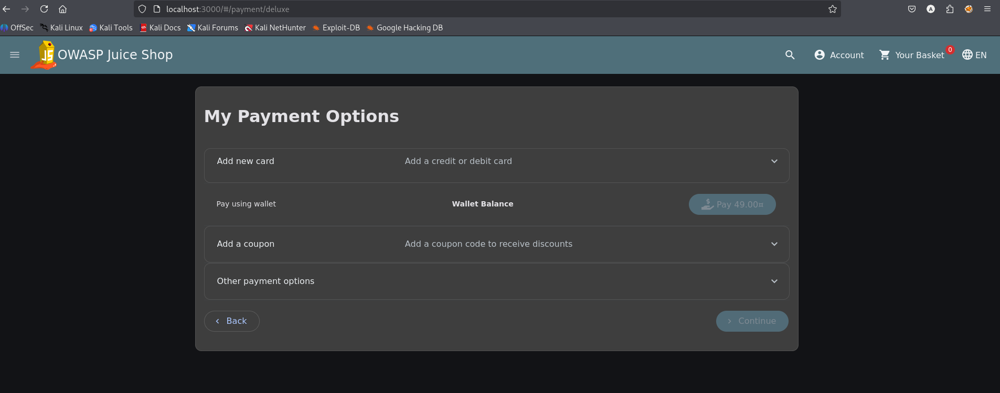
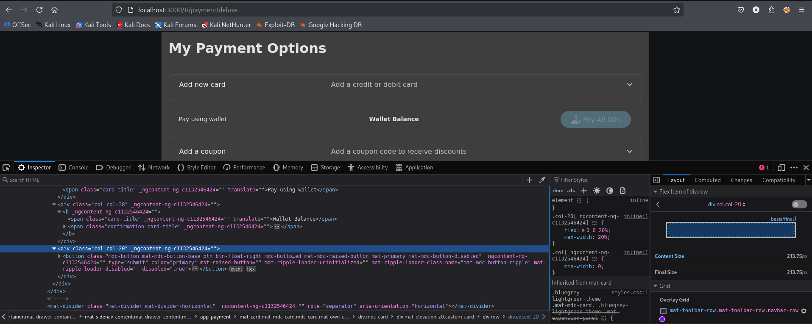
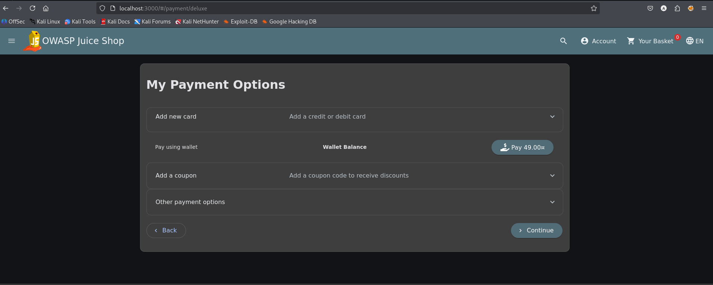
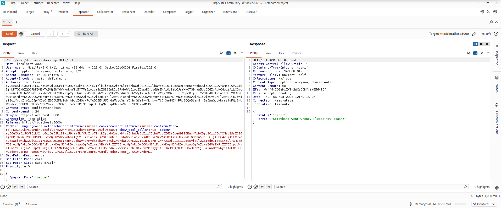

# Test T-A06-02 -- Tentative bloquée de déblocage du paiement Deluxe côté client

**Catégorie :** A06 -- Insecure Design (Conception non sécurisée)

**Statut :** aucune vulnérabilité de paiement confirmée ; le serveur a rejeté la requête modifiée

**1. Description générale**

Ce test vise à vérifier si le bouton de paiement de la page d'abonnement Deluxe, désactivé côté interface lorsque le solde du portefeuille est insuffisant, ne repose que sur une restriction visuelle côté client (attribut disabled) sans validation équivalente et fiable côté serveur.

**2. Faille spécifique**

Le bouton « Pay » de la page /#/payment/deluxe est désactivé via l'attribut HTML disabled lorsque le solde du portefeuille de l'utilisateur est insuffisant pour couvrir le montant de l'abonnement (49¤). Cette restriction est appliquée uniquement côté client (rendu Angular) et peut être supprimée directement dans l'inspecteur du navigateur, ce qui rend la requête déclenchable depuis le navigateur. Toutefois, la preuve recueillie montre que le serveur a rejeté la requête. La modification du DOM seule ne constitue donc pas une vulnérabilité de paiement confirmée.

**3. Étapes de reproduction**

1.  Accéder à la page d'abonnement Deluxe (/#/deluxe-membership) avec un compte dont le solde du portefeuille est insuffisant (0¤).

2.  Sélectionner le mode de paiement « Pay using wallet » : le bouton de paiement est visiblement désactivé (grisé, attribut disabled présent).

3.  Ouvrir l'inspecteur du navigateur (DevTools) et localiser l'élément <button> correspondant.

4.  Supprimer manuellement l'attribut disabled="true" de l'élément dans l'inspecteur.

5.  Constater que le bouton devient visuellement actif et cliquable.

6.  Cliquer sur le bouton pour déclencher la requête de paiement et observer la réponse du serveur.

**4. Preuve de concept**

Bouton de paiement désactivé côté interface pour un solde insuffisant :

*Figure 47. Bouton de paiement désactivé (attribut disabled) pour un solde de portefeuille insuffisant.*

Localisation et suppression de l'attribut disabled dans l'inspecteur du navigateur :

*Figure 48. Élément bouton inspecté, avec l'attribut disabled="true" visible dans le code HTML rendu.*

Bouton devenu actif après manipulation du DOM :

*Figure 49. Bouton de paiement rendu actif après suppression de l'attribut disabled côté client.*

Résultat de la tentative de paiement : requête interceptée et réponse du serveur :

*Figure 50. Requête POST /rest/deluxe-membership rejetée par le serveur (400 Bad Request) malgré le déblocage du bouton côté client.*

**5. Impact**

Cette tentative d'exploitation, telle que menée (mode de paiement « wallet » avec solde insuffisant), n'a pas abouti : le serveur a correctement rejeté la requête POST /rest/deluxe-membership (400 Bad Request), ce qui indique qu'une revalidation du solde est bien effectuée côté serveur pour ce mode de paiement précis. Le test confirme uniquement qu'il est possible de réactiver visuellement le bouton et d'envoyer la requête ; il confirme aussi que le serveur l'a rejetée. Aucune perte financière ni acquisition d'abonnement sans paiement n'a été constatée. Le résultat est donc une tentative bloquée et un contrôle serveur observé, pas une faille exploitable démontrée. Ce résultat n'exclut pas la possibilité que d'autres modes de paiement de la même page (carte bancaire, coupon) présentent un comportement différent ; ces vecteurs n'ont pas été testés à ce stade et pourront faire l'objet d'un complément d'audit.

**6. Remédiation**

-   Ne jamais se reposer sur la désactivation d'un élément d'interface comme seul mécanisme de contrôle d'accès à une fonctionnalité sensible.

-   Continuer à appliquer, et documenter explicitement, la revalidation systématique côté serveur de toutes les conditions métier (solde suffisant, statut du compte) avant toute opération de paiement, pour l'ensemble des modes de paiement proposés.

-   Compléter l'audit en testant les vecteurs de paiement non couverts par ce test (carte bancaire, coupon) afin de vérifier l'homogénéité de la validation serveur sur l'ensemble du flux de paiement Deluxe.
