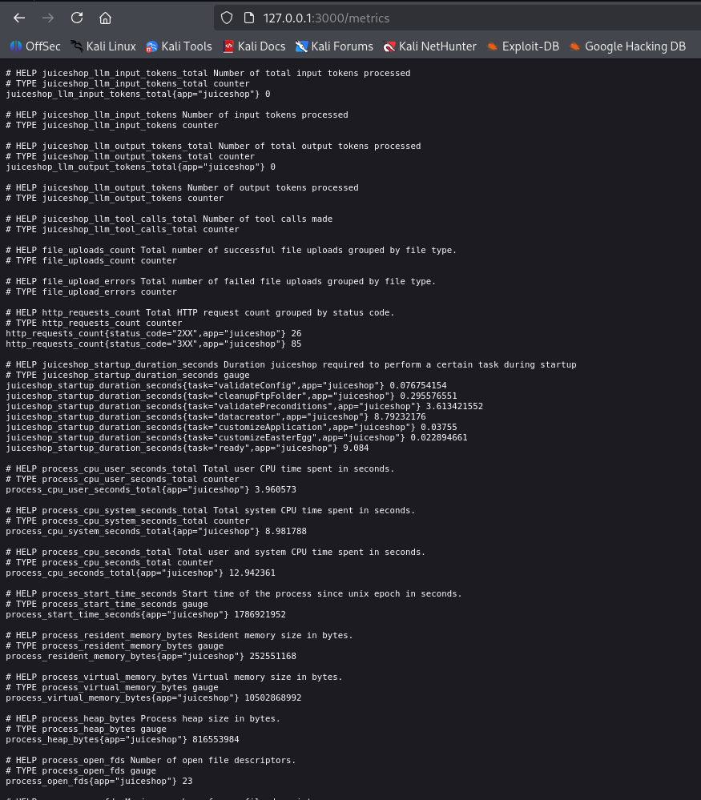

# Test T-A09-01 -- Exposition publique de l'endpoint de métriques applicatives (Exposed Metrics)

**Catégorie :** A09 -- Security Logging & Alerting Failures (Défaillances de journalisation et d'alerte de sécurité)

**1. Description générale**

Ce test vise à vérifier si l'application expose publiquement un endpoint de métriques techniques et métier destiné en principe à un système de supervision interne (type Prometheus), et si cet endpoint est accessible sans authentification ni restriction réseau.

**2. Faille spécifique**

L'endpoint /metrics de l'application est accessible publiquement sans aucune authentification, à l'adresse <http://localhost:3000/metrics>. La réponse, au format standard Prometheus, expose trois catégories de données normalement réservées à un usage interne d'administration : des métriques d'infrastructure système (utilisation CPU/mémoire, version exacte du runtime Node.js v24.17.0, temps de démarrage de l'application), des métriques métier (juiceshop_orders_placed_total : 3, juiceshop_users_registered_total : 22, juiceshop_wallet_balance_total : 13887), ainsi que des métriques liées à la progression de challenges de sécurité (juiceshop_challenges_solved, juiceshop_cheat_score), révélant potentiellement à un observateur externe l'état d'avancement d'un audit de sécurité en cours sur l'instance.

**3. Étapes de reproduction**

1.  Accéder directement, sans authentification préalable, à l'URL <http://localhost:3000/metrics>.

2.  Constater que le serveur retourne une réponse 200 OK au format texte standard Prometheus, sans aucun contrôle d'accès.

3.  Analyser le contenu retourné et identifier les trois catégories de métriques exposées (système, métier, challenges de sécurité).

4.  Relever les valeurs métier sensibles exposées (nombre de commandes, solde total des portefeuilles utilisateurs, nombre d'utilisateurs enregistrés) ainsi que la version exacte du runtime et de l'application.

**4. Preuve de concept**

Réponse de l'endpoint /metrics accessible sans authentification, exposant les métriques système, métier et de progression des challenges :

*Figure 65. Accès direct et sans authentification à l'endpoint /metrics, exposant les métriques internes de l'application au format Prometheus.*

**5. Impact**

| Aspect | Impact | Sévérité |
|---|---|---|
| Confidentialité | Exposition de données métier internes (volumes de commandes, solde total des portefeuilles, nombre d'utilisateurs) et de la version exacte du runtime | Élevée |
| Intégrité | Sans objet (lecture seule) | Faible |
| Disponibilité | Facilite la préparation d'une attaque par déni de service, l'attaquant connaissant déjà la charge système actuelle | Moyenne |

La version exacte de Node.js et de l'application permet à un attaquant de cibler précisément des CVE connues pour ces versions, sans avoir à les deviner — un lien direct avec les failles de composants obsolètes déjà identifiées dans la catégorie A03 de cet audit. Le solde total des portefeuilles utilisateurs et le nombre d'utilisateurs constituent par ailleurs des indicateurs métier qu'un concurrent ou un attaquant ne devrait jamais pouvoir observer depuis l'extérieur. Un attaquant peut enfin observer ces métriques en continu afin d'identifier les périodes de faible trafic et planifier une attaque à ce moment précis, sans laisser de trace suspecte (une simple requête GET, indiscernable d'un usage normal).

**6. Remédiation**

-   Restreindre l'accès à l'endpoint /metrics par authentification et par filtrage d'adresse IP, en n'autorisant que le réseau de monitoring interne.

-   Isoler l'endpoint /metrics sur un port distinct non exposé publiquement (pratique standard Prometheus, port dédié type 9100).

-   Ajouter une authentification par token dédiée au système de scraping Prometheus.

-   Centraliser l'accès aux métriques via un reverse proxy n'autorisant que le serveur de supervision interne à interroger cet endpoint.
