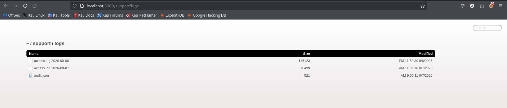
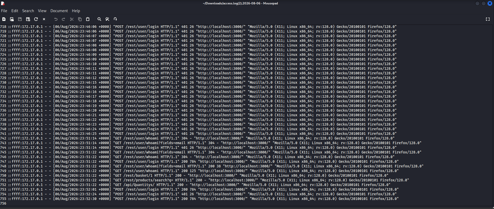
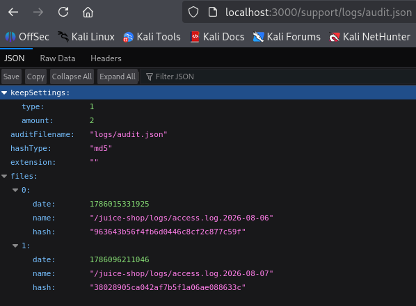

# Test T-A09-02 -- Exposition du répertoire de journalisation (Access Log)

**Catégorie principale :** A02 -- Security Misconfiguration (répertoire de journaux publié par HTTP)

**Lien secondaire :** A01 pour l'exposition de données. A09 concerne ici la protection et la détection des journaux, mais le seul listing public ne prouve pas une absence d'alertes.

**1. Description générale**

Ce test vise à vérifier si les fichiers de journalisation (logs d'accès) de l'application sont accessibles publiquement, alors qu'ils contiennent par nature des informations sensibles sur l'activité des utilisateurs et le comportement interne du serveur.

**2. Faille spécifique**

Le répertoire /support/logs/ est accessible publiquement sans authentification à l'adresse <http://localhost:3000/support/logs/>, exposant un listing de trois fichiers : deux journaux d'accès quotidiens (access.log.2026-08-06, 146 123 octets ; access.log.2026-08-07, 93 471 octets) ainsi qu'un fichier de métadonnées audit.json. L'analyse du journal du 06/08/2026 révèle une séquence de plus de trente tentatives de connexion consécutives sur l'endpoint /rest/user/login, espacées de moins d'une seconde chacune, toutes en échec (401) sauf la dernière (200) — une séquence compatible avec des tentatives automatisées. Aucun code 429 ni blocage n'est visible dans cet extrait ; cette observation ne suffit pas à conclure à l'absence générale de limitation de tentatives. Le fichier audit.json confirme par ailleurs le chemin absolu réel du serveur (/juice-shop/logs/) et révèle l'usage d'une empreinte MD5 pour la vérification d'intégrité des logs — un algorithme aujourd'hui obsolète et vulnérable aux attaques par collision.

**3. Étapes de reproduction**

1.  Accéder à l'URL <http://localhost:3000/support/logs/> sans authentification.

2.  Constater le listage public du répertoire, exposant les fichiers access.log.2026-08-06, access.log.2026-08-07 et audit.json.

3.  Ouvrir et analyser le contenu du fichier access.log.2026-08-06, en portant attention aux séquences de requêtes répétées sur /rest/user/login.

4.  Identifier la séquence de tentatives de connexion en échec (401) suivie d'un succès (200), caractéristique d'une attaque par force brute.

5.  Ouvrir le fichier audit.json et relever le chemin serveur absolu ainsi que l'algorithme de hachage utilisé pour l'intégrité des logs.

**4. Preuve de concept**

Listing public du répertoire /support/logs/ :

*Figure 66. Listing public du répertoire /support/logs/, exposant les fichiers de journalisation access.log et audit.json.*

*Figure 67. Contenu du fichier access.log téléchargé, révélant une série de tentatives de connexion échouées caractéristique d'une attaque par force brute non détectée.*

Contenu du fichier audit.json, exposant le chemin absolu du serveur et le mécanisme d'intégrité MD5 :

*Figure 68. Contenu du fichier audit.json, révélant le chemin d'installation absolu du serveur et le mécanisme de hachage MD5 utilisé pour l'intégrité des journaux.*

**5. Impact**

| Aspect | Impact | Sévérité |
|---|---|---|
| Confidentialité | Exposition des adresses IP, user-agents et chemins observés dans les journaux consultés ; exposition du chemin absolu du serveur | Élevée |
| Intégrité | Sans objet (accès en lecture seule) | Faible |
| Disponibilité | Aucune indisponibilité n'a été démontrée ; la séquence visible justifie un contrôle complémentaire du rate limiting | Non évaluée |

Le journal montre une séquence de tentatives rapprochées ayant abouti à une connexion réussie. L'extrait ne permet pas à lui seul de conclure que l'endpoint est dépourvu de toutes protections contre les tentatives répétées. Les endpoints appelés après une connexion réussie révèlent par ailleurs le parcours type d'un utilisateur légitime, exploitable pour concevoir une attaque de phishing ciblée et crédible. Cette séquence est un indice à comparer aux tests contrôlés décrits dans T-A07 ; elle n'établit pas, à elle seule, le résultat de ces tests. Les adresses IP peuvent être des données personnelles selon le contexte. La seule capture ne permet pas de conclure à une non-conformité juridique ; la durée de conservation, la finalité, les mesures de protection et le contexte de traitement doivent être évalués.

**6. Remédiation**

-   Retirer le répertoire de logs du webroot public : les fichiers de logs ne doivent jamais résider dans un chemin accessible via une route HTTP publique, mais dans un chemin système dédié hors de portée du serveur web.

-   Restreindre, à défaut, l'accès à ce répertoire par authentification et filtrage d'adresse IP.

-   Implémenter un rate-limiting sur l'endpoint d'authentification (ex. 5 tentatives maximum par fenêtre de 15 minutes).

-   Migrer vers un algorithme de hachage sécurisé (SHA-256 minimum) pour la vérification d'intégrité des logs, à la place de MD5.

-   Centraliser les logs vers un système de gestion dédié (ELK Stack, Graylog, Splunk) avec contrôle d'accès basé sur les rôles, et mettre en place une détection automatique de patterns d'attaque (SIEM).

-   Définir une politique de conservation et de protection des journaux adaptée au contexte et aux obligations applicables ; faire valider les aspects juridiques par la personne compétente.
