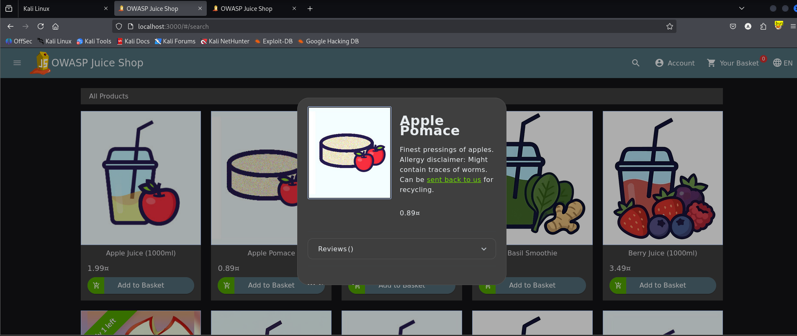
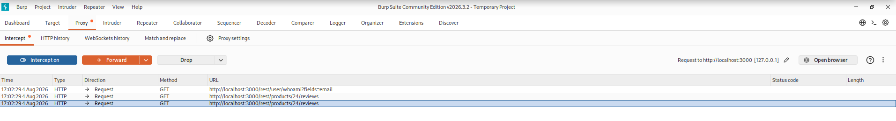
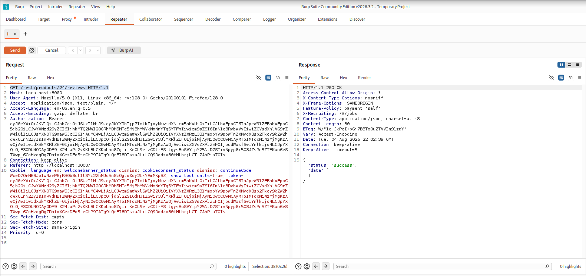
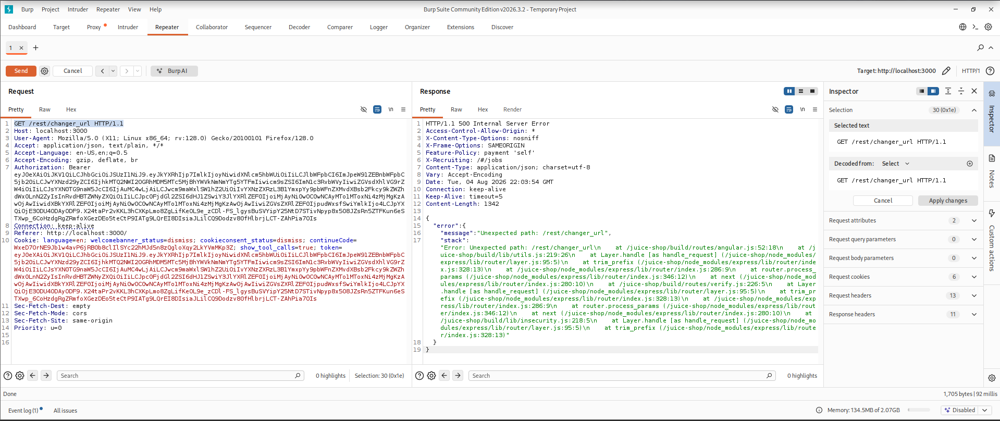

# Test T-A10-01 -- Divulgation d'informations sensibles via un message d'erreur non maîtrisé (Error Handling)

**Catégorie :** A10 -- Mishandling of Exceptional Conditions (Mauvaise gestion des conditions exceptionnelles)

**1. Description générale**

Ce test vise à provoquer volontairement une erreur serveur non prévue afin de vérifier si l'application gère ses exceptions de façon maîtrisée (message générique) ou si elle expose au client des informations techniques internes normalement destinées aux seuls journaux serveur.

**2. Faille spécifique**

L'application ne dispose pas d'un gestionnaire d'erreurs générique intercalé avant la réponse au client : lorsqu'une route inexistante ou un paramètre inattendu déclenche une exception non gérée, le serveur Express renvoie directement au client la trace d'exécution complète (stack trace) telle que produite par le moteur Node.js, plutôt qu'un message neutre.

**3. Étapes de reproduction**

1.  Naviguer normalement sur l'application et observer une requête légitime (ex. GET /rest/products/24/reviews) interceptée via Burp Suite, afin d'établir un comportement de référence.

2.  Modifier dans Burp Suite Repeater le chemin de la requête vers une route inexistante et inattendue : GET /rest/changer_url.

3.  Envoyer la requête modifiée et observer la réponse retournée par le serveur.

4.  Analyser en détail le contenu de la réponse d'erreur (code de statut, corps de la réponse).

**4. Preuve de concept**

Contexte : navigation normale sur une fiche produit, requête de référence interceptée dans Burp Suite :

*Figure 69. Consultation normale d'une fiche produit sur l'application.*

*Figure 70. Requête de référence interceptée dans Burp Suite (Proxy).*

Requête de référence rejouée dans Repeater, réponse nominale (200 OK) :

*Figure 71. Réponse nominale (200 OK) de l'endpoint /rest/products/24/reviews, utilisée comme référence.*

Requête modifiée vers une route inattendue : le serveur renvoie une erreur 500 avec la stack trace complète en clair dans le corps de la réponse :

*Figure 72. Erreur 500 Internal Server Error exposant la stack trace complète de l'application (chemins de fichiers, structure interne, version d'Express).*

**5. Impact**

Chaque élément de cette réponse d'erreur constitue une fuite d'information distincte : le message révèle la structure des routes de l'application et confirme l'existence du préfixe /rest/ ; la stack trace divulgue le chemin d'exécution interne complet de l'application ainsi que les chemins absolus des fichiers sources sur le serveur (/juice-shop/build/routes/angular.js, /juice-shop/build/lib/utils.js) ; le framework web utilisé (Express) et sa configuration interne sont identifiables ; enfin, les noms de modules internes (utils.js, verify.js, insecurity.js) renseignent un attaquant sur l'architecture logicielle de l'application.

Prise isolément, cette fuite ne compromet pas directement le système, mais elle facilite considérablement la phase de reconnaissance d'un attaquant : elle permet d'orienter et d'affiner des attaques ultérieures plus ciblées, notamment des tentatives d'injection SQL exploitant la connaissance précise des chemins et de la structure interne de l'application (voir tests de la catégorie A05 -- Injection).

**6. Remédiation**

-   Mettre en place un gestionnaire d'erreurs générique (error-handling middleware) intercalé en fin de chaîne de traitement Express, qui capture toute exception non gérée et renvoie systématiquement un message neutre au client (ex. « Une erreur est survenue »).

-   Journaliser le détail technique complet de chaque exception (stack trace, contexte) côté serveur uniquement, dans un système de logs non accessible depuis l'extérieur.

-   Désactiver le mode de débogage détaillé (stack traces, messages verbeux) sur tout environnement de production.

-   Tester systématiquement le comportement de l'application face à des entrées et des routes inattendues avant mise en production.
